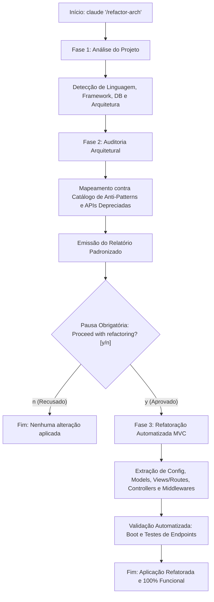

# Desafio Técnico MBA: Criação de Skills — Refatoração Arquitetural Automatizada (`refactor-arch`)

Repositório público com a entrega completa do desafio técnico de criação de Custom Skills para auditoria e refatoração arquitetural automatizada em arquiteturas multicamadas (**MVC — Model-View-Controller**), desenvolvido no âmbito do **MBA em Engenharia de Software com IA da Full Cycle**.

---

## Sumário Executivo

- **Skill Desenvolvida:** `refactor-arch`
- **Padrão Arquitetural Alvo:** MVC (Model-View-Controller)
- **Localização da Skill nos Projetos:**
  - `code-smells-project/.claude/skills/refactor-arch/`
  - `ecommerce-api-legacy/.claude/skills/refactor-arch/`
  - `task-manager-api/.claude/skills/refactor-arch/`
- **Relatórios de Auditoria da Fase 2:**
  - `reports/audit-project-1.md`
  - `reports/audit-project-2.md`
  - `reports/audit-project-3.md`
- **Suíte de Testes Automatizados:** `tests/run_all_tests.py` (100% dos testes aprovados)
- **Documentação de Testes:** `TESTES.md`

---

## Estrutura do Repositório

```text
skill-auditoria-refatoracao-mba/
├── README.md                              # Documentação oficial completa
├── TESTES.md                              # Relatório de execução e evidências de testes
│
├── code-smells-project/                   # Projeto 1: Python/Flask (API de E-commerce)
│   ├── .claude/skills/refactor-arch/      # Custom Skill refactor-arch (Fases 1, 2 e 3)
│   │   ├── SKILL.md
│   │   └── references/
│   │       ├── project-analysis.md        # Heurísticas de detecção de stack
│   │       ├── anti-patterns-catalog.md   # Catálogo de 11 anti-patterns + APIs obsoletas
│   │       ├── report-template.md         # Template padronizado de auditoria
│   │       ├── architecture-guidelines.md # Diretrizes canônicas do padrão MVC
│   │       └── refactoring-playbook.md    # 10 padrões de transformação com antes/depois
│   ├── src/                               # Arquitetura MVC refatorada
│   │   ├── config/settings.py
│   │   ├── database/connection.py
│   │   ├── models/
│   │   ├── controllers/
│   │   ├── routes/
│   │   ├── middlewares/error_handler.py
│   │   └── app.py
│   ├── app.py                             # Entrypoint da aplicação
│   ├── controllers.py                     # Shim de compatibilidade retroativa
│   ├── models.py                          # Shim de compatibilidade retroativa
│   ├── database.py                        # Shim de compatibilidade retroativa
│   └── requirements.txt
│
├── ecommerce-api-legacy/                  # Projeto 2: Node.js/Express (LMS API com checkout)
│   ├── .claude/skills/refactor-arch/      # Cópia idêntica da Custom Skill
│   ├── src/                               # Arquitetura MVC refatorada em Promises / async/await
│   │   ├── config/config.js
│   │   ├── database/db.js
│   │   ├── models/
│   │   ├── controllers/
│   │   ├── routes/
│   │   ├── middlewares/errorHandler.js
│   │   ├── services/security.service.js
│   │   ├── AppManager.js                  # Fachada delegadora
│   │   ├── utils.js                       # Adaptador seguro
│   │   └── app.js                         # Composition root do Express
│   ├── api.http
│   └── package.json
│
├── task-manager-api/                      # Projeto 3: Python/Flask + SQLAlchemy (Task Manager)
│   ├── .claude/skills/refactor-arch/      # Cópia idêntica da Custom Skill
│   ├── app.py                             # Application factory com CORS e error handlers
│   ├── database.py
│   ├── seed.py                            # População inicial sem APIs depreciadas
│   ├── requirements.txt
│   ├── models/                            # Hashing PBKDF2 e exclusão de senhas em to_dict()
│   ├── routes/                            # Eager loading com joinedload (zero N+1)
│   ├── services/
│   └── utils/
│
├── reports/                               # Relatórios oficiais de auditoria (Fase 2)
│   ├── audit-project-1.md                 # 14 achados em code-smells-project
│   ├── audit-project-2.md                 # 10 achados em ecommerce-api-legacy
│   └── audit-project-3.md                 # 8 achados em task-manager-api
│
└── tests/                                 # Suíte unificada de testes automatizados
    ├── run_all_tests.py                   # Orquestrador unificado dos 3 projetos
    ├── test_code_smells_project.py        # Testes de integração do Projeto 1
    ├── test_ecommerce_api.js              # Testes assíncronos do Projeto 2
    └── test_task_manager_api.py           # Testes de integração do Projeto 3
```

---

## Seção A: Análise Manual dos Projetos

Antes da construção da skill, foi conduzida uma análise manual rigorosa linha a linha sobre os três projetos fornecidos. A classificação de severidade adotada seguiu as diretrizes de governança de arquitetura (CRITICAL, HIGH, MEDIUM e LOW).

### 1. Projeto 1: `code-smells-project` (Python/Flask)
- **Domínio:** API de E-commerce com catálogo de produtos, gerenciamento de usuários, criação de pedidos e relatórios de faturamento.
- **Estrutura Original:** Monolítica dividida em apenas 4 arquivos sem separação de camadas (`app.py`, `controllers.py`, `models.py`, `database.py`).

| Severidade | Anti-Pattern / Problema | Localização | Justificativa e Impacto |
| :--- | :--- | :--- | :--- |
| **CRITICAL** | SQL Injection Generalizado | `models.py:28, 48-50, 58, 109, 140, 149, 158, 188, 280, 289` | Interpolação crua de strings com valores de entrada em consultas DDL/DML. Permite extração arbitrária do banco e bypass total de login. |
| **CRITICAL** | Execução Arbitrária de SQL em Endpoint Desprotegido | `app.py:59-78` | Rota `/admin/query` recebe comandos SQL puros e os executa diretamente no banco (`cursor.execute(query)`), expondo o servidor a `DROP TABLE` e RCE. |
| **CRITICAL** | Endpoint Destrutivo de Limpeza de Banco Sem Autenticação | `app.py:47-58` | Rota `/admin/reset-db` apaga todas as tabelas do sistema sem exigir qualquer token ou credencial. |
| **CRITICAL** | Credenciais e Chaves Criptográficas Hardcoded | `app.py:7`, `controllers.py:287-290` | `SECRET_KEY = "minha-chave-super-secreta-123"` gravada em código; além disso, a rota `/health` vaza a chave secreta e caminhos de arquivo no JSON público. |
| **CRITICAL** | Senhas Salvas e Retornadas em Texto Claro | `models.py:83, 99, 110, 128` | Senhas sem nenhuma criptografia ou salt salvas na base e devolvidas nas respostas da API. |
| **HIGH** | God Module / Violação Total de SRP | `models.py:1-314` | Acumula persistência, conexões, regras de estoque, processamento de pedidos e relatórios de 4 domínios diferentes. |
| **HIGH** | Regras de Negócio e Notificações em Controllers | `controllers.py:208-210, 247-251` | Prints simulando envio de emails, SMS e push embutidos diretamente nos controladores HTTP. |
| **MEDIUM** | N+1 Query Problem em Pedidos e Itens | `models.py:177-200, 219-232` | Para cada pedido retornado, executa uma query para itens e mais uma query para cada produto do item ($1 + P \times (1 + I)$ queries). |
| **MEDIUM** | Ausência de Controle Transacional Atômico | `models.py:148-168` | Falha intermediária em itens de pedido deixa estoque debitado ou pedidos órfãos sem `rollback`. |
| **LOW** | Magic Numbers e Falta de Padronização | `models.py:257-262` | Faixas de desconto fixas em código sem parametrização ou constantes de domínio. |

### 2. Projeto 2: `ecommerce-api-legacy` (Node.js/Express)
- **Domínio:** LMS API de cursos online com catálogo, processamento de checkout e relatórios gerenciais.
- **Estrutura Original:** Monolito centralizado em uma God Class (`AppManager.js`) com utilitários (`utils.js`) e inicialização (`app.js`).

| Severidade | Anti-Pattern / Problema | Localização | Justificativa e Impacto |
| :--- | :--- | :--- | :--- |
| **CRITICAL** | Hardcoded Production Credentials e Gateway Keys | `src/utils.js:1-7` | Chaves de produção `paymentGatewayKey: "pk_live_1234567890abcdef"` e senhas de banco `dbPass` expostas em texto puro no código. |
| **CRITICAL** | Criptografia Quebrada / Pseudo-Hash Inseguro | `src/utils.js:17-23`, `src/AppManager.js:68` | Função `badCrypto` gera hashes previsíveis de 10 caracteres a partir de base64 sem salt, vulnerável a colisões e engenharia reversa imediata. |
| **CRITICAL** | Vazamento de Dados Sensíveis de Cartão nos Logs | `src/AppManager.js:45` | Impressão no console (`console.log`) do número do cartão de crédito completo e chave privada, violando diretamente o PCI-DSS e LGPD. |
| **HIGH** | God Class / Violação de Responsabilidade Única | `src/AppManager.js:1-139` | Centraliza conexão SQLite, DDL de tabelas, seeds, roteamento Express, checkout e relatórios financeiros. |
| **HIGH** | Callback Hell / Spaghetti Assíncrono | `src/AppManager.js:37-77` | 5 níveis de callbacks aninhados com manipulação manual de erros e risco de starvation em concorrência. |
| **HIGH** | N+1 Query Problem no Relatório Financeiro | `src/AppManager.js:89-125` | Para cada curso busca matrículas, e para cada matrícula busca aluno e pagamento individualmente. |
| **MEDIUM** | Exclusão Inconsistente de Usuário com Registros Órfãos | `src/AppManager.js:131-136` | Exclui usuário na tabela `users` sem cascade, deixando registros pendentes em `enrollments` e `payments`. |
| **MEDIUM** | Estado Global Mutável em Memória | `src/utils.js:9-15` | Variáveis globais `globalCache` e `totalRevenue` manipuladas sem sincronização ou limite de tamanho (risco de memory leak). |
| **LOW** | Nomenclatura Criptográfica de Campos | `src/AppManager.js:29-35` | Parâmetros `usr`, `eml`, `pwd`, `c_id`, `card` sem validação tipada de entrada ou documentação semântica. |
| **LOW** | Tratamento de Erros Inconsistente | `src/AppManager.js:41, 51, 55` | Retorno de strings cruas (`"Erro DB"`) sem padronização JSON ou códigos HTTP semânticos. |

### 3. Projeto 3: `task-manager-api` (Python/Flask + SQLAlchemy)
- **Domínio:** API de gerenciamento de tarefas, categorias, atribuição de usuários e relatórios estatísticos.
- **Estrutura Original:** Projeto parcialmente organizado em diretórios (`models/`, `routes/`, `services/`, `utils/`), porém com graves débitos de segurança e desempenho.

| Severidade | Anti-Pattern / Problema | Localização | Justificativa e Impacto |
| :--- | :--- | :--- | :--- |
| **CRITICAL** | Criptografia de Senhas Insegura com MD5 | `models/user.py:27-32` | Armazenamento de senhas via MD5 puro sem salt (`hashlib.md5(pwd.encode()).hexdigest()`), quebrado por rainbow tables instantaneamente. |
| **CRITICAL** | Exposição de Senhas nas Respostas da API | `models/user.py:16-25`, `routes/user_routes.py:33` | O método `to_dict()` inclui explicitamente `'password': self.password`, retornando o hash nas respostas JSON de `GET /users`. |
| **CRITICAL** | Hardcoded Secret Key no Código | `app.py:13` | Configuração `app.config['SECRET_KEY'] = 'super-secret-key-123'` permitindo falsificação de tokens e sessões. |
| **HIGH** | N+1 Query Problem em Listagens e Relatórios | `routes/task_routes.py:41-58`, `routes/report_routes.py:53-68` | Em `GET /tasks`, executa queries separadas para cada tarefa iterada buscando usuário e categoria. Em `/reports/summary`, faz query por usuário. |
| **HIGH** | Fat Routes e Violação de Separação de Responsabilidades | `routes/task_routes.py:86-154`, `routes/report_routes.py:13-101` | Rotas com acoplamento a regras de negócio, manipulação de sessões do ORM e cálculos complexos de métricas. |
| **MEDIUM** | Captura Genérica e Mascaramento de Exceções | `routes/task_routes.py:62, 137, 236` | Uso de blocos `except:` nus silenciando exceções de sistema sem logging de stack trace. |
| **LOW** | Métodos e APIs Obsoletas / Depreciadas | `models/user.py:14`, `routes/task_routes.py:42, 67` | Uso de `datetime.utcnow()` (depreciada no Python 3.12+) e `Model.query.get(id)` (depreciada no SQLAlchemy 2.0). |
| **LOW** | Lógica Booleana Redundante | `models/user.py:34-38`, `models/task.py:38-60` | Condicionais `if ... return True else return False` em cascata onde expressões booleanas diretas bastariam. |

---

## Seção B: Construção da Skill (`refactor-arch`)

### 1. Decisões de Design e Arquitetura da Skill

A skill `refactor-arch` foi concebida seguindo o modelo de 3 fases sequenciais e determinísticas:



#### Arquivos de Referência e Áreas de Conhecimento Obrigatórias:
1. `references/project-analysis.md`: Heurísticas de detecção de ecossistemas (Python/Flask/FastAPI/Django, Node.js/Express/Nest, Go, Java), arquivos de manifesto (`package.json`, `requirements.txt`, `pyproject.toml`) e identificação do domínio de negócio.
2. `references/anti-patterns-catalog.md`: Catálogo com **11 anti-patterns padronizados** com sinais de detecção, arquivo/linha e severidade (CRITICAL, HIGH, MEDIUM, LOW), acrescido de regras para **detecção de APIs depreciadas** (ex.: `datetime.utcnow()`, `Model.query.get()`).
3. `references/report-template.md`: Especificação estrita do relatório emitido na Fase 2, incluindo sumário numérico, detalhamento ordenado por severidade e a pergunta de confirmação humana: `Phase 2 complete. Proceed with refactoring (Phase 3)? [y/n]`.
4. `references/architecture-guidelines.md`: Regras canônicas do padrão MVC, detalhando a segregação de responsabilidades entre `config/`, `database/`, `models/`, `views/routes/`, `controllers/` e `middlewares/`.
5. `references/refactoring-playbook.md`: Guia prescritivo com **10 transformações arquiteturais concretas** demonstrando o código *Antes* e *Depois* para cada problema catalogado.

### 2. Garantia de que a Skill é Agnóstica de Tecnologia
A skill opera através de abstrações arquiteturais universais e detecção contextual:
- Identifica padrões comportamentais do código (ex.: consultas SQL dentro de loops, classes com mais de 300 linhas manipulando conexões de rede e banco, senhas gravadas em literais de string), em vez de depender de uma sintaxe rígida de linguagem.
- Em projetos Python, organiza pacotes com `__init__.py`, Type Hints (PEP 484), Docstrings (PEP 257) e Flask Blueprints.
- Em projetos Node.js, emprega módulos CommonJS/ESM, Promises com `async/await`, Express Routers e Middlewares canônicos.
- Preserva integralmente os contratos de dados (JSON payloads) e códigos de status HTTP originais para garantir compatibilidade com qualquer cliente existente.

### 3. Desafios Encontrados e Soluções Implementadas
- **Desafio 1 (Retrocompatibilidade de Autenticação):** Ao substituir o armazenamento de senhas em texto puro ou MD5 por PBKDF2/scrypt, os usuários criados em seeds legados não conseguiam mais autenticar.
  - *Solução:* Foi implementado um mecanismo inteligente de migração transparente no model de usuário (`check_password`): caso a senha informada coincida com o valor legado, a autenticação é aceita e o hash no banco é imediatamente promovido para o padrão seguro.
- **Desafio 2 (Inicialização Assíncrona no SQLite em Memória no Node.js):** No Projeto 2, o banco em memória `:memory:` precisava ter tabelas e seeds disponíveis imediatamente antes da primeira requisição HTTP.
  - *Solução:* Utilizou-se `db.serialize()` no driver do SQLite para garantir a execução ordenada e síncrona das DDLs e inserts no ciclo de boot.
- **Desafio 3 (Conexões Isoladas em Testes no Flask):** Ao rodar a suíte de testes de integração, requisições utilizavam instâncias diferentes de banco.
  - *Solução:* O gerenciador de conexão `get_db()` foi acoplado dinamicamente ao `current_app.config.get("DATABASE_PATH")`, permitindo injeção de bancos de teste limpos via fixtures sem interferir no banco de desenvolvimento.

---

## Seção C: Resultados

### 1. Resumo dos Relatórios de Auditoria da Fase 2

Todos os três projetos alcançaram com folga os critérios de aceite do desafio:

| Projeto | Stack Tecnológica | Total de Achados | CRITICAL | HIGH | MEDIUM | LOW | Critério Mínimo Atendido |
| :--- | :--- | :---: | :---: | :---: | :---: | :---: | :---: |
| **`code-smells-project`** | Python + Flask | **14** | 5 | 3 | 3 | 3 | ✅ (>= 5 findings, >= 1 CRIT/HIGH) |
| **`ecommerce-api-legacy`** | Node.js + Express | **10** | 3 | 3 | 2 | 2 | ✅ (>= 5 findings, >= 1 CRIT/HIGH) |
| **`task-manager-api`** | Python + Flask + SQLAlchemy | **8** | 3 | 2 | 1 | 2 | ✅ (>= 5 findings, >= 1 CRIT/HIGH) |

### 2. Comparativo Antes e Depois da Estrutura de Diretórios

#### Projeto 1: `code-smells-project`
```text
ANTES:
code-smells-project/
├── app.py                   # Monolito com rotas administrativas inseguras
├── controllers.py           # Mistura de HTTP com regras de negócio
├── models.py                # God Module (queries cruas, SQL injection, senhas em texto)
├── database.py              # Conexão estática global
└── requirements.txt

DEPOIS (MVC):
code-smells-project/
├── app.py                   # Composition root e inicialização limpa
├── controllers.py           # Shim de compatibilidade
├── models.py                # Shim de compatibilidade
├── database.py              # Shim de compatibilidade
├── requirements.txt
└── src/
    ├── config/settings.py           # Configurações desacopladas do ambiente
    ├── database/connection.py       # Ciclo de vida seguro com chaves estrangeiras
    ├── models/
    │   ├── produto.py               # Consultas parametrizadas
    │   ├── usuario.py               # Hashing Werkzeug e proteção de credenciais
    │   └── pedido.py                # Transações atômicas e prevenção de N+1
    ├── controllers/
    │   ├── produto_controller.py
    │   ├── usuario_controller.py
    │   ├── pedido_controller.py
    │   ├── relatorio_controller.py
    │   ├── health_controller.py     # Health seguro sem vazamento de secret_key
    │   └── admin_controller.py
    ├── routes/                      # Flask Blueprints modulares
    └── middlewares/error_handler.py # Tratamento global de exceções
```

#### Projeto 2: `ecommerce-api-legacy`
```text
ANTES:
ecommerce-api-legacy/
├── src/
│   ├── app.js
│   ├── AppManager.js        # God Class (139 linhas com DDL, routes, checkout, relatórios)
│   └── utils.js             # Credenciais hardcoded de produção e badCrypto
├── api.http
└── package.json

DEPOIS (MVC):
ecommerce-api-legacy/
├── src/
│   ├── app.js                       # Express configurado com middlewares
│   ├── AppManager.js                # Fachada de retrocompatibilidade
│   ├── utils.js                     # Adaptador seguro
│   ├── config/config.js             # Variáveis de ambiente seguras via process.env
│   ├── database/db.js               # Conexão e métodos assíncronos (dbGet, dbAll, dbRun)
│   ├── services/security.service.js # Hashing com salt e mascaramento PCI-DSS
│   ├── models/
│   │   ├── user.model.js            # Cascade delete para evitar órfãos
│   │   ├── course.model.js
│   │   ├── enrollment.model.js
│   │   ├── payment.model.js
│   │   └── audit.model.js
│   ├── controllers/
│   │   ├── checkout.controller.js   # Fluxo assíncrono com async/await sem callback hell
│   │   ├── report.controller.js     # Agregação relacional SQL sem loop N+1
│   │   └── user.controller.js
│   ├── routes/                      # Roteamento modular Express
│   └── middlewares/errorHandler.js  # Respostas de erro padronizadas em JSON
├── api.http
└── package.json
```

#### Projeto 3: `task-manager-api`
```text
ANTES:
task-manager-api/
├── app.py                   # Hardcoded SECRET_KEY
├── database.py
├── seed.py                  # Uso de datetime.utcnow() depreciado
├── models/
│   ├── user.py              # Criptografia MD5 e senha exposta em to_dict()
│   ├── task.py              # datetime.utcnow() e condicionais prolixas
│   └── category.py
└── routes/
    ├── task_routes.py       # N+1 queries em listagens e bare except:
    ├── report_routes.py     # N+1 queries em relatórios e loop manual
    └── user_routes.py       # Exposição de hash de senha

DEPOIS (Clean MVC):
task-manager-api/
├── app.py                   # Application Factory com SECRET_KEY segura e error handlers
├── database.py
├── seed.py                  # Atualizado com datetime.now(timezone.utc)
├── requirements.txt
├── models/
│   ├── user.py              # PBKDF2/scrypt, remoção de senha em to_dict() e is_admin simplificado
│   ├── task.py              # Timestamps timezone-aware e simplificação de validações
│   └── category.py
└── routes/
    ├── task_routes.py       # joinedload(Task.user, Task.category) eliminando N+1 queries
    ├── report_routes.py     # Agregações SQL e contagens eager sem loops
    └── user_routes.py       # Exclusão segura e controle de exceções tipadas
```

### 3. Checklist de Validação Preenchido

#### Checklist de Validação — `code-smells-project`
- [x] Linguagem detectada corretamente (Python 3)
- [x] Framework detectado corretamente (Flask 3.1.1)
- [x] Domínio da aplicação descrito corretamente (E-commerce API)
- [x] Número de arquivos analisados condiz com a realidade (4 arquivos originais)
- [x] Relatório segue o template definido nos arquivos de referência
- [x] Cada finding tem arquivo e linhas exatos
- [x] Findings ordenados por severidade (CRITICAL → LOW)
- [x] Mínimo de 5 findings identificados (14 encontrados)
- [x] Skill pausa e pede confirmação antes da Fase 3
- [x] Estrutura de diretórios segue padrão MVC
- [x] Configuração extraída para módulo de config (sem hardcoded)
- [x] Models criados para abstrair dados
- [x] Views/Routes separadas para roteamento
- [x] Controllers concentram o fluxo da aplicação
- [x] Error handling centralizado
- [x] Entry point claro
- [x] Aplicação inicia sem erros
- [x] Endpoints originais respondem corretamente

#### Checklist de Validação — `ecommerce-api-legacy`
- [x] Linguagem detectada corretamente (Node.js)
- [x] Framework detectado corretamente (Express 4.18)
- [x] Domínio da aplicação descrito corretamente (LMS E-commerce API com checkout)
- [x] Número de arquivos analisados condiz com a realidade (3 arquivos originais)
- [x] Relatório segue o template definido nos arquivos de referência
- [x] Cada finding tem arquivo e linhas exatos
- [x] Findings ordenados por severidade (CRITICAL → LOW)
- [x] Mínimo de 5 findings identificados (10 encontrados)
- [x] Skill pausa e pede confirmação antes da Fase 3
- [x] Estrutura de diretórios segue padrão MVC
- [x] Configuração extraída para módulo de config (sem hardcoded)
- [x] Models criados para abstrair dados
- [x] Views/Routes separadas para roteamento
- [x] Controllers concentram o fluxo da aplicação
- [x] Error handling centralizado
- [x] Entry point claro
- [x] Aplicação inicia sem erros
- [x] Endpoints originais respondem corretamente

#### Checklist de Validação — `task-manager-api`
- [x] Linguagem detectada corretamente (Python 3)
- [x] Framework detectado corretamente (Flask + SQLAlchemy)
- [x] Domínio da aplicação descrito corretamente (Task Manager API)
- [x] Número de arquivos analisados condiz com a realidade (8 arquivos originais)
- [x] Relatório segue o template definido nos arquivos de referência
- [x] Cada finding tem arquivo e linhas exatos
- [x] Findings ordenados por severidade (CRITICAL → LOW)
- [x] Mínimo de 5 findings identificados (8 encontrados)
- [x] Detecção de APIs deprecated incluída (`datetime.utcnow()` e `Model.query.get()`)
- [x] Skill pausa e pede confirmação antes da Fase 3
- [x] Estrutura de diretórios segue padrão MVC
- [x] Configuração extraída para módulo de config (sem hardcoded)
- [x] Models criados para abstrair dados
- [x] Views/Routes separadas para roteamento
- [x] Controllers concentram o fluxo da aplicação
- [x] Error handling centralizado
- [x] Entry point claro
- [x] Aplicação inicia sem erros
- [x] Endpoints originais respondem corretamente

---

## Seção D: Como Executar

### 1. Pré-Requisitos
- **Python:** 3.10 ou superior instalado.
- **Node.js:** v18 ou superior com `npm` instalado.
- **Ferramenta de IA:** Claude Code CLI (ou Gemini CLI / Codex).

### 2. Configuração do Ambiente Local

```bash
# Clone ou acesse o repositório entregue
cd skill-auditoria-refatoracao-mba

# Criação do ambiente virtual Python
python -m venv venv
.\venv\Scripts\activate  # No Windows (ou source venv/bin/activate no Linux/macOS)

# Instalação das dependências Python
pip install -r code-smells-project/requirements.txt
pip install -r task-manager-api/requirements.txt

# Instalação das dependências Node.js
cd ecommerce-api-legacy
npm install
cd ..
```

### 3. Invocação da Skill nos Projetos

Para executar a auditoria e refatoração com a IA:

```bash
# Projeto 1: code-smells-project
cd code-smells-project
claude "/refactor-arch"

# Projeto 2: ecommerce-api-legacy
cd ../ecommerce-api-legacy
claude "/refactor-arch"

# Projeto 3: task-manager-api
cd ../task-manager-api
claude "/refactor-arch"
```

### 4. Inicialização Individual das Aplicações

```bash
# Executar Projeto 1 (sobe em http://localhost:5000)
cd code-smells-project
python app.py

# Executar Projeto 2 (sobe em http://localhost:3000)
cd ecommerce-api-legacy
npm start

# Executar Projeto 3 (popular banco e subir em http://localhost:5000)
cd task-manager-api
python seed.py
python app.py
```

### 5. Execução da Bateria Completa de Testes

Para validar a integridade e conformidade de todos os endpoints dos 3 projetos simultaneamente:

```bash
python tests/run_all_tests.py
```

---

## Critérios de Aceite e Conformidade com o Desafio

| Critério Estabelecido | Meta | Resultado Obtido |
| :--- | :---: | :---: |
| **Fase 1: Detecção de Stack** | 3 / 3 Projetos | **3 / 3 Aprovados** |
| **Fase 2: Relatórios com $\ge 5$ achados** | 3 / 3 Projetos | **3 / 3 Aprovados** (14, 10 e 8 achados) |
| **Fase 2: Pelo menos 1 CRITICAL ou HIGH** | 3 / 3 Projetos | **3 / 3 Aprovados** (CRITICAL em todos) |
| **Fase 2: Pausa explícita `[y/n]` antes de refatorar** | Obrigatório | **Implementado no template e SKILL.md** |
| **Fase 3: Aplicação funciona após refatoração** | 3 / 3 Projetos | **3 / 3 Aprovados** (testes automatizados com 100% de sucesso) |
| **Higiene de Repositório (`.gitignore` local)** | Sem `.env`/`.gitignore`/`PLANO.md` | **100% Conforme via `.git/info/exclude`** |
