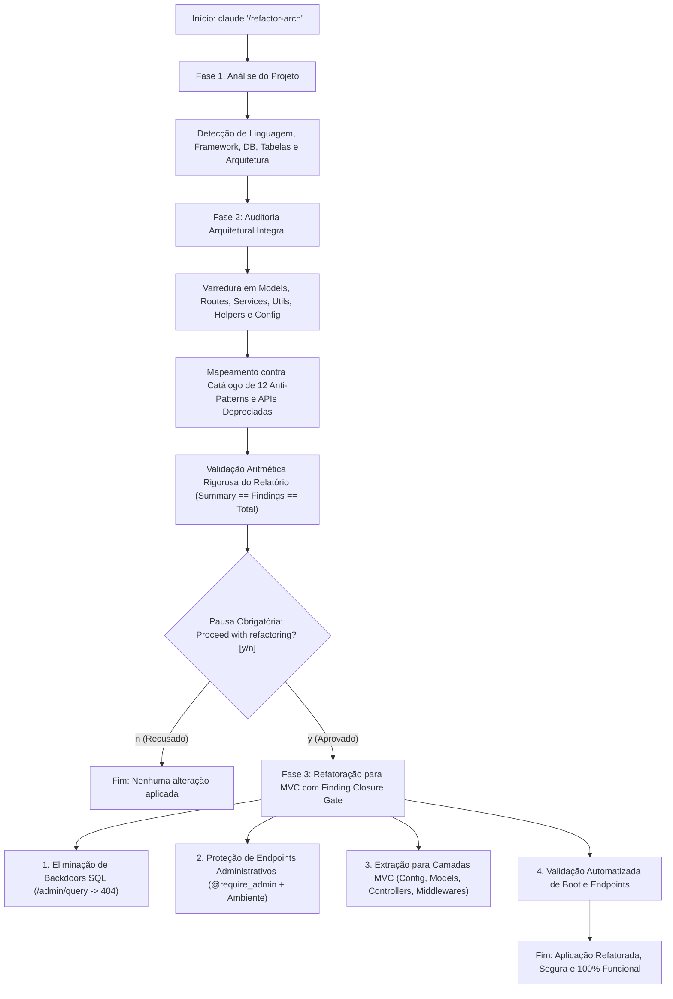

# Desafio Técnico MBA: Criação de Skills — Refatoração Arquitetural Automatizada (`refactor-arch`)

Repositório público com a entrega completa do desafio técnico de criação de Custom Skills para auditoria e refatoração arquitetural automatizada em arquiteturas multicamadas (**MVC — Model-View-Controller**), desenvolvido no âmbito do **MBA em Engenharia de Software com IA da Full Cycle**.

---

## Sumário Executivo

- **Skill Desenvolvida:** `refactor-arch`
- **Padrão Arquitetural Alvo:** MVC (Model-View-Controller)
- **Localização da Skill nos Projetos (Hashes SHA-256 100% Idênticos):**
  - `code-smells-project/.claude/skills/refactor-arch/`
  - `ecommerce-api-legacy/.claude/skills/refactor-arch/`
  - `task-manager-api/.claude/skills/refactor-arch/`
- **Relatórios de Auditoria da Fase 2:**
  - `reports/audit-project-1.md` (14 achados `[F1]`–`[F14]`: 6 CRITICAL, 2 HIGH, 3 MEDIUM, 3 LOW)
  - `reports/audit-project-2.md` (12 achados `[F1]`–`[F12]`: 5 CRITICAL, 2 HIGH, 3 MEDIUM, 2 LOW)
  - `reports/audit-project-3.md` (12 achados `[F1]`–`[F12]`: 4 CRITICAL, 1 HIGH, 5 MEDIUM, 2 LOW)
- **Finding Closure Gate:** Todos os 38 achados levantados na Fase 2 foram integralmente sanados na Fase 3, com blindagem adicional contra escalação de privilégio e falhas *fail-open*:
  - Endpoints vulneráveis de execução SQL arbitrária (`/admin/query`) foram **completamente removidos** da tabela de rotas (retornando HTTP 404).
  - Endpoints administrativos sensíveis e destrutivos (`/admin/reset-db` no Projeto 1 e `GET /api/admin/financial-report` no Projeto 2) são protegidos por `@require_admin` / `requireAdmin` com Bearer token assinado (`itsdangerous` / HMAC-SHA256 com chave via `SECRET_KEY` ou CSPRNG efêmero), revalidação de papel administrativo diretamente no banco SQLite e trava **Fail-Closed** no reset de banco (`ENVIRONMENT` ausente assume `"production"` e retorna `403`).
  - Endpoints públicos de cadastro (`POST /usuarios`, `POST /api/checkout`, `POST /users`) ignoram campos privilegiados (`tipo`/`role`), atribuindo sempre o papel de menor privilégio (`cliente`/`student`/`user`), enquanto `POST /login` em todos os projetos emite tokens assinados criptograficamente (sem tokens falsos literais).
- **Suíte de Testes E2E 100% Reais (Zero Mocks):** `tests/run_all_tests.py` (22 cenários/suítes = 5 + 12 + 5 black-box subindo servidores reais `python app.py`, `node src/app.js` e `python seed.py` sem `test_client()` nem mocks, 100% aprovados)
- **Documentação de Testes:** `TESTES.md`

---

## Estrutura do Repositório

```text
skill-auditoria-refatoracao-mba/
├── README.md                              # Documentação oficial completa
├── TESTES.md                              # Relatório de execução e evidências de testes
│
├── code-smells-project/                   # Projeto 1: Python/Flask (API de E-commerce)
│   ├── .claude/skills/refactor-arch/      # Custom Skill refactor-arch (Fases 1, 2 e 3)
│   │   ├── SKILL.md                       # Fluxo em 3 fases com Finding Closure Gate
│   │   └── references/
│   │       ├── project-analysis.md        # Heurísticas de detecção de stack
│   │       ├── anti-patterns-catalog.md   # Catálogo de 12 anti-patterns + APIs obsoletas
│   │       ├── report-template.md         # Template padronizado com IDs [F<N>] e soma exata
│   │       ├── architecture-guidelines.md # Diretrizes canônicas do padrão MVC (SoC estrito)
│   │       └── refactoring-playbook.md    # 12 padrões de transformação com antes/depois
│   ├── src/                               # Arquitetura MVC refatorada
│   │   ├── config/settings.py             # Configurações fail-closed e CSPRNG efêmero
│   │   ├── database/connection.py         # Gerenciamento de conexão e transações
│   │   ├── models/                        # Camada de dados pura (Zero SQL nos controllers)
│   │   │   ├── produto.py                 # Consultas parametrizadas
│   │   │   ├── usuario.py                 # Hashing Werkzeug, hmac e proteção de senhas
│   │   │   ├── pedido.py                  # Transações atômicas, constantes e zero N+1
│   │   │   ├── admin.py                   # AdminModel para reset transacional seguro
│   │   │   └── health.py                  # HealthModel (abstração de métricas)
│   │   ├── controllers/                   # Orquestração HTTP (anti-Mass Assignment)
│   │   │   ├── produto_controller.py      # Validação de queries, tipos e constraints nomeadas
│   │   │   ├── usuario_controller.py      # Cadastro fixado em 'cliente' + Bearer token
│   │   │   ├── pedido_controller.py
│   │   │   ├── relatorio_controller.py
│   │   │   ├── health_controller.py
│   │   │   └── admin_controller.py        # Orquestração delegando ao AdminModel
│   │   ├── services/                      # Serviços de domínio desacoplados
│   │   │   ├── pedido_service.py          # Regras comerciais de pedidos
│   │   │   └── notification_service.py    # Despacho estruturado de notificações
│   │   ├── routes/                        # Blueprints modulares (sem /admin/query)
│   │   │   └── admin_routes.py            # /admin/reset-db protegido por @require_admin
│   │   ├── middlewares/                   # Middlewares globais
│   │   │   ├── auth_middleware.py         # @require_admin (fail-closed + revalidação DB + itsdangerous)
│   │   │   └── error_handler.py           # Tratamento global sem vazamento de stack trace
│   │   └── app.py                         # Application Factory
│   ├── app.py                             # Entrypoint da aplicação
│   ├── controllers.py                     # Shim de compatibilidade retroativa
│   ├── models.py                          # Shim de compatibilidade retroativa
│   ├── database.py                        # Shim de compatibilidade retroativa
│   ├── README.md
│   └── requirements.txt
│
├── ecommerce-api-legacy/                  # Projeto 2: Node.js/Express (LMS API com checkout)
│   ├── .claude/skills/refactor-arch/      # Cópia idêntica da Custom Skill (SHA-256 verificado)
│   ├── src/                               # Arquitetura MVC refatorada em Promises / async/await
│   │   ├── config/config.js               # Variáveis fail-closed e secretKey efêmera CSPRNG
│   │   ├── database/db.js                 # Inicialização com papel e seed hasheada PBKDF2
│   │   ├── services/security.service.js   # PBKDF2, HMAC-SHA256 timingSafeEqual e PCI-DSS
│   │   ├── models/                        # Camada de persistência relacional
│   │   │   ├── user.model.js              # Deleção em lote e suporte a role sem escalação
│   │   │   ├── course.model.js
│   │   │   ├── enrollment.model.js
│   │   │   ├── payment.model.js
│   │   │   ├── report.model.js            # Agregação SQL isolada (sem SQL no controller)
│   │   │   └── audit.model.js
│   │   ├── controllers/
│   │   │   ├── auth.controller.js         # Login com emissão de token HMAC-SHA256
│   │   │   ├── checkout.controller.js     # Nomes semânticos, BoundedCache, papel fixo 'student'
│   │   │   ├── report.controller.js       # Relatório financeiro via ReportModel
│   │   │   └── user.controller.js         # Proteção contra exclusão de contas admin
│   │   ├── routes/                        # Express Routers (report.routes.js com requireAdmin)
│   │   ├── middlewares/
│   │   │   ├── authMiddleware.js          # Guard requireAdmin com revalidação no SQLite
│   │   │   └── errorHandler.js            # Respostas de erro padronizadas em JSON
│   │   ├── AppManager.js                  # Fachada delegadora de compatibilidade
│   │   ├── utils.js                       # BoundedCache (max 500 itens) sem memory leak
│   │   └── app.js                         # Composition root do Express
│   ├── api.http
│   ├── package.json
│   ├── package-lock.json
│   └── README.md
│
├── task-manager-api/                      # Projeto 3: Python/Flask + SQLAlchemy (Task Manager)
│   ├── .claude/skills/refactor-arch/      # Cópia idêntica da Custom Skill (SHA-256 verificado)
│   ├── config/
│   │   └── settings.py                    # Classe Config fail-closed com SMTP e secretKey CSPRNG
│   ├── controllers/                       # Camada Controller desacoplada das rotas
│   │   ├── task_controller.py             # Validação de query params e reuso de helpers
│   │   ├── user_controller.py             # Login com token assinado e anti-Mass Assignment
│   │   └── report_controller.py           # Agregações SQL, cor hexadecimal e zero N+1
│   ├── middlewares/
│   │   ├── auth_middleware.py             # Emissão/verificação de token via itsdangerous
│   │   └── error_handler.py               # Manipulador centralizado sem vazamento de exceção
│   ├── models/                            # Hashing PBKDF2/scrypt (zero MD5), SQLAlchemy 2.0
│   ├── routes/                            # Blueprints limpos delegando aos Controllers
│   ├── services/
│   │   └── notification_service.py        # SMTP desacoplado e sem senha hardcoded
│   ├── utils/
│   │   └── helpers.py                     # Helpers limpos, sem imports mortos e integrados aos controllers
│   ├── app.py                             # Composition root desacoplado
│   ├── database.py
│   ├── seed.py                            # População inicial sem APIs depreciadas
│   ├── README.md
│   └── requirements.txt
│
├── reports/                               # Relatórios oficiais de auditoria (Fase 2)
│   ├── audit-project-1.md                 # 14 achados em code-smells-project (soma exata 14)
│   ├── audit-project-2.md                 # 12 achados em ecommerce-api-legacy (soma exata 12)
│   └── audit-project-3.md                 # 12 achados em task-manager-api (soma exata 12)
│
└── tests/                                 # Suíte unificada de testes E2E reais (Zero Mocks)
    ├── run_all_tests.py                   # Orquestrador unificado dos 3 projetos
    ├── test_code_smells_project.py        # 5 suítes (2 processos reais + Red-Team /admin e Mass Assignment)
    ├── test_ecommerce_api.js              # 12 cenários E2E reais (RBAC /admin, HMAC, PCI-DSS e SQLite)
    └── test_task_manager_api.py           # 5 suítes (seed.py + app.py reais + tokens assinados + DB audit)
```

---

## Seção A: Análise Manual dos Projetos

Antes da construção e execução da skill, foi conduzida uma análise manual aprofundada sobre as três codebases fornecidas. A classificação de severidade adotou a régua de governança oficial (**CRITICAL**, **HIGH**, **MEDIUM** e **LOW**), cumprindo estritamente as cotas mínimas exigidas ($\ge 1$ CRITICAL/HIGH, $\ge 2$ MEDIUM, $\ge 2$ LOW para cada projeto).

### 1. Projeto 1: `code-smells-project` (Python/Flask)
- **Domínio:** API de E-commerce com catálogo de produtos, gestão de usuários, processamento de pedidos e relatórios de faturamento.
- **Estrutura Original:** Monolítica desestruturada dividida em 4 arquivos (`app.py`, `controllers.py`, `models.py`, `database.py`).

| Severidade | Anti-Pattern / Problema | Localização | Justificativa e Impacto |
| :--- | :--- | :--- | :--- |
| **CRITICAL** | SQL Injection Generalizado | `models.py:28, 48-50, 58, 109, 140, 149, 158, 188, 280, 289` | Interpolação direta de strings em queries SQL. Permite extração arbitrária de dados e bypass total de autenticação. |
| **CRITICAL** | Execução Arbitrária de SQL em Endpoint Administrativo | `app.py:59-78` | Rota `/admin/query` recebe comandos SQL do cliente e executa diretamente no banco (`cursor.execute(query)`), configurando um backdoor grave. |
| **CRITICAL** | Endpoint Destrutivo de Reset de Banco Sem Autenticação | `app.py:47-58` | Rota `/admin/reset-db` apaga todas as tabelas do sistema sem checagem de permissão ou token. |
| **CRITICAL** | Credenciais Hardcoded e Vazamento de Dados Sensíveis | `app.py:7`, `controllers.py:287-290` | `SECRET_KEY = "minha-chave-super-secreta-123"` gravada em código; rota `/health` vaza `secret_key` e caminhos internos no JSON. |
| **CRITICAL** | Senhas Armazenadas e Retornadas em Texto Claro | `models.py:83, 99, 110, 128` | Senhas salvas sem hashing e expostas no payload de retorno da API. |
| **CRITICAL** | God Module / Violação Total de SRP | `models.py:1-314` | Módulo acumula persistência, conexões, regras de estoque, processamento de pedidos e relatórios de 4 domínios diferentes. |
| **HIGH** | Lógica de Negócio e Notificações em Controllers | `controllers.py:208-210, 247-251` | Handlers HTTP concentram prints de SMS/email e manipulação de estoque misturados ao transporte. |
| **HIGH** | Estado Global Mutável e Conexão Compartilhada | `database.py:7-14` | Variável global `db` reutilizada sem pool ou context manager, vulnerável a race conditions. |
| **MEDIUM** | N+1 Query Problem em Pedidos e Itens | `models.py:177-200, 219-232` | Ao listar pedidos, dispara uma query adicional por item e por produto ($1 + P \times (1 + I)$ queries). |
| **MEDIUM** | Ausência de Tratamento Centralizado de Erros | `controllers.py:10-12, 60-63, 143-145` | Múltiplos blocos `try/except` repetitivos retornando `str(e)`, vazando detalhes internos no erro 500. |
| **MEDIUM** | Conversões Ingênuas de Query Parameters sem Validação | `controllers.py:114-115` | `float(request.args.get('preco_min'))` sem tratamento de exceção causa crash 500 em inputs malformados. |
| **LOW** | Magic Numbers e Strings Sem Constantes | `controllers.py:47, 49, 52`, `models.py:122, 257-262` | Limites `len(nome) < 2`, `len(nome) > 200` e faixas de desconto (`10000`, `5000`, `1000`) fixados como literais soltos no código. |
| **LOW** | Logging Não Estruturado com Concatenação | `controllers.py:8, 57, 106, 208-210` | Uso de `print("Texto " + str(valor))` em vez de biblioteca padronizada de logs (`logging`). |
| **LOW** | Roteamento Procedural Manual | `app.py:11-30` | Registro sequencial de rotas com `add_url_rule` sem agrupamento por recurso ou Blueprints. |

### 2. Projeto 2: `ecommerce-api-legacy` (Node.js/Express)
- **Domínio:** LMS API de cursos online com catálogo, processamento de checkout e relatórios gerenciais.
- **Estrutura Original:** Monolito centralizado em uma God Class (`AppManager.js`) com utilitários (`utils.js`) e inicialização (`app.js`).

| Severidade | Anti-Pattern / Problema | Localização | Justificativa e Impacto |
| :--- | :--- | :--- | :--- |
| **CRITICAL** | Hardcoded Production Credentials e Gateway Keys | `src/utils.js:1-7` | Chaves de gateway `paymentGatewayKey: "pk_live_1234567890abcdef"` e senhas de banco expostas em código. |
| **CRITICAL** | Criptografia Quebrada / Pseudo-Hash e Seed em Texto Claro | `src/utils.js:17-23`, `src/AppManager.js:18, 68` | Função `badCrypto` trunca saída Base64 em 10 caracteres sem salt, e seed inicial grava senha `'123'` em texto puro. |
| **CRITICAL** | Vazamento de Dados de Cartão e Chave nos Logs (PCI-DSS) | `src/AppManager.js:45` | Impressão no console do número completo do cartão de crédito e chave do gateway (`console.log`), violando PCI-DSS e LGPD. |
| **CRITICAL** | Endpoint Administrativo de Relatório Financeiro Sem Autenticação | `src/AppManager.js:80-129` | Rota `/api/admin/financial-report` expõe publicamente faturamento por curso, nomes de alunos e pagamentos sem nenhum token ou RBAC. |
| **CRITICAL** | God Class / Violação Total de Responsabilidade Única | `src/AppManager.js:1-141` | Centraliza conexão SQLite, DDL de tabelas, seeds, roteamento Express, checkout e relatórios. |
| **HIGH** | Callback Hell / Spaghetti Assíncrono | `src/AppManager.js:37-77, 89-128` | 5 níveis de callbacks aninhados no endpoint de checkout com manipulação manual de concorrência em relatórios. |
| **HIGH** | Estado Global Mutável em Memória | `src/utils.js:9-15`, `src/AppManager.js:59` | Variáveis globais `globalCache` e `totalRevenue` manipuladas sem sincronização ou limite de tamanho (memory leak). |
| **MEDIUM** | N+1 Query Problem no Relatório Financeiro | `src/AppManager.js:89-125` | Para cada curso busca matrículas, e para cada matrícula busca aluno e pagamento individualmente ($1 + C + 2CE$). |
| **MEDIUM** | Exclusão Inconsistente de Usuário com Registros Órfãos | `src/AppManager.js:131-136` | Exclui usuário na tabela `users` sem cascade, deixando registros pendentes em `enrollments` e `payments`. |
| **MEDIUM** | Tratamento de Erros Descentralizado em Texto Cru | `src/AppManager.js:41, 51, 55, 70, 84` | Retorno de strings cruas (`"Erro DB"`) sem middleware centralizado nem padronização JSON. |
| **LOW** | Parâmetros de Requisição e Identificadores Crípticos | `src/AppManager.js:29-35` | Variáveis de uma letra (`u`, `e`, `p`, `cid`, `cc`) prejudicando legibilidade e manutenção. |
| **LOW** | Magic Numbers e Literais Soltos | `src/AppManager.js:19, 46, 68`, `src/utils.js:19-22` | Prefixos e constantes numéricas (`"4"`, `10000`, truncamento `10`) espalhados sem constantes nomeadas. |

### 3. Projeto 3: `task-manager-api` (Python/Flask + SQLAlchemy)
- **Domínio:** API de gerenciamento de tarefas, categorias, atribuição de usuários e relatórios estatísticos.
- **Estrutura Original:** Projeto parcialmente organizado em diretórios (`models/`, `routes/`, `services/`, `utils/` — 11 módulos Python analisados), porém com graves débitos de segurança, ausência de camadas `config/`, `controllers/` e `middlewares/` e problemas de robustez.

| Severidade | Anti-Pattern / Problema | Localização | Justificativa e Impacto |
| :--- | :--- | :--- | :--- |
| **CRITICAL** | Criptografia de Senhas Insegura com MD5 | `models/user.py:27-32` | Armazenamento de senhas via MD5 puro sem salt (`hashlib.md5(pwd.encode()).hexdigest()`), quebrado por rainbow tables. |
| **CRITICAL** | Exposição de Senhas nas Respostas da API | `models/user.py:16-25`, `routes/user_routes.py:33` | O método `to_dict()` inclui explicitamente `'password': self.password`, retornando o hash nas respostas JSON. |
| **CRITICAL** | Hardcoded Secret Key, SMTP em Texto Puro e Token Sem Assinatura | `app.py:13`, `services/notification_service.py:7-10`, `routes/user_routes.py:210` | `SECRET_KEY = 'super-secret-key-123'`, senha SMTP `'senha123'` em texto puro e emissão de token fake previsível (`fake-jwt-token-<id>`). |
| **CRITICAL** | Mass Assignment e Escalação de Privilégio em Rotas de Usuário | `routes/user_routes.py:52, 71-78, 119-123` | `POST /users` e `PUT /users/:id` aceitam `role: "admin"` do payload público sem autenticação. |
| **HIGH** | Fat Routes e Violação de Separação de Responsabilidades | `routes/task_routes.py:86-223`, `routes/report_routes.py:13-155` | Rotas acopladas a transações do ORM (`db.session`), validações manuais e cálculos complexos sem Controllers. |
| **MEDIUM** | N+1 Query Problem em Listagens e Relatórios | `routes/task_routes.py:41-58`, `routes/report_routes.py:53-68, 159-163` | Em `GET /tasks`, executa queries separadas por tarefa para usuário e categoria. Em `/reports/summary` e `/categories`, faz queries por usuário e categoria. |
| **MEDIUM** | Uso de APIs Obsoletas / Depreciadas | `models/user.py:14`, `routes/task_routes.py:42, 67`, `notification_service.py:35` | Uso de `datetime.utcnow()` (depreciada no Python 3.12+) e `Model.query.get(id)` (depreciada no SQLAlchemy 2.0). |
| **MEDIUM** | Captura Genérica e Mascaramento de Exceções (Bare Except) | `routes/task_routes.py:62, 134, 236`, `utils/helpers.py:46, 49, 88` | Blocos `except:` nus engolindo erros de sistema e mascarando diagnósticos sem middleware centralizado de erro. |
| **MEDIUM** | Ausência de Validação de Tipos em Filtros de Busca | `routes/task_routes.py:241-271` | Rota `/tasks/search` realiza `int()` direto em query parameters, causando erro 500 em inputs inválidos. |
| **MEDIUM** | Duplicação de Validações (Violação DRY) e Helpers Subutilizados | `utils/helpers.py:58-107`, `routes/task_routes.py:86-154` | Rotas duplicam regex e validações já existentes em `helpers.py`; `is_valid_color` aceita hexadecimais inválidos (`#zzzzzz`). |
| **LOW** | Lógica Booleana Redundante e Verificações Não-Idiomáticas | `models/user.py:34-38`, `models/task.py:38-60`, `helpers.py:19-23, 52-55, 103` | Condicionais `if ... return True else return False` e checagem com `type(tags) == list` em vez de `isinstance`. |
| **LOW** | Imports Mortos/Fora de Escopo, Magic Numbers e Prints de Debug | `utils/helpers.py:1-7, 31-34`, `app.py:7` | 5 imports mortos (`sys`, `math`, `hashlib`, `os`, `json`), import de `uuid` dentro de função e literais sem constantes. |

---

## Seção B: Construção da Skill (`refactor-arch`)

### 1. Decisões de Design, Estrutura da Skill e *Finding Closure Gate*

A skill `refactor-arch` foi estruturada seguindo o modelo modular do Claude Code (`.claude/skills/refactor-arch/`), separando o fluxo orquestrador (`SKILL.md`) das bases de conhecimento especializadas em `references/`. Essa separação mantém o prompt principal enxuto e permite evoluir regras, catálogos e exemplos sem contaminar a lógica de controle das fases:



#### Áreas de Conhecimento Cobertas em `references/`:
1. `references/project-analysis.md`: Heurísticas de inspeção estática para Python (Flask/FastAPI/Django), Node.js (Express/Nest), Go e Java.
2. `references/anti-patterns-catalog.md`: Catálogo padronizado com **12 anti-patterns** e regras de detecção de **APIs deprecated** com equivalentes modernos.
3. `references/report-template.md`: Template obrigatório com identificação única (`[F1]`, `[F2]`...), ordenação por severidade (`CRITICAL` → `LOW`), consistência aritmética exata (`CRITICAL + HIGH + MEDIUM + LOW == Total`) e cotas mínimas.
4. `references/architecture-guidelines.md`: Regras canônicas do padrão MVC alvo (Controllers nunca executam SQL; Models isolam persistência; Middlewares padronizam erros sem vazar stack trace).
5. `references/refactoring-playbook.md`: **12 padrões concretos de transformação** com código *Antes* e *Depois*, incluindo **Padrão 11** (Remoção de Backdoors SQL e Proteção de Endpoints Administrativos) e **Padrão 12** (Extração de *Fat Routes* em projetos parcialmente organizados).

Adicionalmente, a Fase 3 impõe o **Finding Closure Gate**: verificação 1-para-1 comprovando que todos os achados levantados na Fase 2 (`[F1]`..`[Fn]`) foram efetivamente remediados, proibindo apenas relocar um endpoint vulnerável para outro módulo sem corrigi-lo.

### 2. Quais Anti-Patterns Foram Incluídos no Catálogo e Por Quê

O catálogo (`references/anti-patterns-catalog.md`) reúne **12 anti-patterns** calibrados diretamente a partir da análise manual dos 3 projetos e das regras de MVC/SOLID, cobrindo segurança, arquitetura, performance e manutenibilidade:

| # | Anti-Pattern | Severidade | Por que foi incluído no catálogo |
| :---: | :--- | :---: | :--- |
| **1** | **SQL Injection** | `CRITICAL` | Previne interpolação de strings em queries SQL detectada massivamente no `code-smells-project`. |
| **2** | **God Class / God Module** | `CRITICAL` | Ataca arquivos monolíticos (`models.py` e `AppManager.js`) que violam o Princípio da Responsabilidade Única (SRP). |
| **3** | **Hardcoded Secrets, Credentials & Fake Tokens** | `CRITICAL` | Captura chaves, senhas de banco, credenciais SMTP, fallbacks estáticos e tokens literais não assinados (`fake-jwt-token`). |
| **4** | **Weak Cryptography & Sensitive Data Exposure** | `CRITICAL` | Identifica texto plano, MD5 sem salt, `badCrypto` em Base64, vazamento de senhas em `to_dict()` e cartões em logs (PCI-DSS). |
| **5** | **Unprotected `/admin*`, SQL Backdoors, Mass Assignment & Fail-Open** | `CRITICAL` | Heurística universal sinalizando toda rota `/admin*` sem auth/admin (`/admin/query`, `/admin/reset-db`, `/api/admin/financial-report`), `tipo`/`role` em cadastros públicos e defaults `development`. |
| **6** | **Business Logic in Controllers / Fat Routes** | `HIGH` | Separa regras de domínio, cálculos e ORM acoplados em rotas (`controllers.py`, `routes/task_routes.py`). |
| **7** | **Tight Coupling, Callback Hell & Global Mutable State** | `HIGH` | Detecta pirâmides de callbacks no Node.js (`AppManager.js`) e estado global mutável compartilhado (`globalCache`, `totalRevenue`). |
| **8** | **N+1 Query Problem** | `MEDIUM` | Corrige loops disparando queries por item em listagens e relatórios nos 3 projetos. |
| **9** | **Deprecated APIs and Outdated Patterns** | `MEDIUM` | Detecta `datetime.utcnow()` (Python 3.12+) e `Model.query.get(id)` (SQLAlchemy 2.0) sugerindo substitutos canônicos. |
| **10** | **Missing Centralized Error Handling & Bare Excepts** | `MEDIUM` | Elimina blocos `except:` nus e padroniza handlers globais de erro sem expor detalhes internos. |
| **11** | **Magic Numbers, Poor Naming, Dead Imports & Redundant Booleans** | `LOW` | Combate identificadores crípticos (`u`, `e`, `cid`, `cc`), literais soltos (`10000`, `5000`, `4`) e código morto. |
| **12** | **Missing Route Validation, Orphan Records & DRY Violations** | `MEDIUM` | Impede crashes 500 (`preco_min=abc`, `priority=abc`), registros órfãos sem cascata e validações duplicadas fora de helpers. |

### 3. Como Garantimos que a Skill é Agnóstica de Tecnologia

- **Heurísticas baseadas em comportamento arquitetural:** Os sinais de detecção descrevem padrões semânticos universais (ex.: consulta executada dentro de laço `for`, credencial literal em atribuição de configuração, método HTTP contendo transação SQL), complementados por manifestos específicos por ecossistema apenas na camada de detecção (`project-analysis.md`).
- **Diretrizes estruturais equivalentes entre stacks:** `architecture-guidelines.md` define as mesmas 6 responsabilidades (`config/`, `database/`, `models/`, `controllers/`, `routes|views/`, `middlewares/`) mapeáveis tanto para **Python/Flask** (Blueprints, `werkzeug.security`, SQLAlchemy/`sqlite3`) quanto para **Node.js/Express** (Routers, `crypto.pbkdf2Sync`, Promises/`async/await`), além de orientar FastAPI, Django, NestJS, Go e Java.
- **Adaptação ao nível de maturidade do projeto:** O playbook distingue monólitos desestruturados (**Padrão 2**) de projetos parcialmente organizados com *Fat Routes* (**Padrão 12**), evitando reescritas destrutivas e preservando 100% os contratos HTTP/JSON existentes.
- **Replicabilidade comprovada:** As pastas `.claude/skills/refactor-arch/` nos 3 projetos possuem conteúdo idêntico (validado por SHA-256) sem nenhuma referência hardcoded a um projeto específico.

### 4. Desafios Encontrados e Soluções Implementadas

- **Desafio 1 — Endpoints administrativos vulneráveis apenas "movidos" na primeira versão:** Inicialmente, `/admin/query` e `/admin/reset-db` haviam sido extraídos para `admin_routes.py` sem eliminar o risco nem exigir autenticação.
  - *Solução:* Criação do **Padrão 11** no playbook e do **Finding Closure Gate** no `SKILL.md`, remoção total de `/admin/query` (retornando `404`) e proteção de `/admin/reset-db` via `@require_admin` (`itsdangerous` Bearer token + papel `admin` + whitelist estrita de ambiente `development`/`testing`).
- **Desafio 2 — Retrocompatibilidade de autenticação com seeds legados:** Migrar senhas de texto claro ou MD5 para PBKDF2/scrypt quebrava o login de usuários criados antes da refatoração.
  - *Solução:* Implementação de verificação com fallback legado e promoção automática para hash PBKDF2 seguro no primeiro login válido (`UsuarioModel.autenticar` e `User.check_password`).
- **Desafio 3 — Inicialização assíncrona no SQLite `:memory:` em Node.js:** Ao modularizar `AppManager.js`, as queries do seed poderiam ocorrer em paralelo antes da criação das tabelas.
  - *Solução:* Uso de `db.serialize()` no `initDb()` com ativação de `PRAGMA foreign_keys = ON;`, seed já hasheada com `hashPassword('123')` e encapsulamento de `dbGet`/`dbAll`/`dbRun` em Promises.
- **Desafio 4 — Isolamento de conexões de banco em testes no Flask:** O singleton global de conexão impedia injetar bancos de teste limpos entre suítes.
  - *Solução:* Vinculação da conexão ao `flask.g` respeitando `current_app.config.get("DATABASE_PATH")` e propagação explícita de `ENVIRONMENT` no `create_app()`.
- **Observação de Escopo — Configuração de CORS (`CORS_ORIGINS`):** Por utilizarem autenticação stateless via header `Authorization: Bearer` (e não cookies de sessão vulneráveis a CSRF cross-origin) e manterem o escopo focado nos anti-patterns MVC/SOLID do catálogo, as APIs preservam origem permissiva por padrão para compatibilidade local, porém aceitam restrição explícita de domínios em produção via variável de ambiente `CORS_ORIGINS` em `config/settings.py`.

---

## Seção C: Resultados

### 1. Resumo dos Relatórios de Auditoria da Fase 2 (Consistência Aritmética 100%)

| Projeto | Stack Tecnológica | Total de Achados | CRITICAL | HIGH | MEDIUM | LOW | Critério Mínimo Atendido |
| :--- | :--- | :---: | :---: | :---: | :---: | :---: | :---: |
| **`code-smells-project`** | Python + Flask | **14** | 6 | 2 | 3 | 3 | ✅ ($\ge 5$ findings, $\ge 1$ CRIT/HIGH, $\ge 2$ MED, $\ge 2$ LOW) |
| **`ecommerce-api-legacy`** | Node.js + Express | **12** | 5 | 2 | 3 | 2 | ✅ ($\ge 5$ findings, $\ge 1$ CRIT/HIGH, $\ge 2$ MED, $\ge 2$ LOW) |
| **`task-manager-api`** | Python + Flask + SQLAlchemy | **12** | 4 | 1 | 5 | 2 | ✅ ($\ge 5$ findings, $\ge 1$ CRIT/HIGH, $\ge 2$ MED, $\ge 2$ LOW) |

### 2. Comparativo Antes e Depois da Estrutura de Diretórios

#### Projeto 1: `code-smells-project`
```text
ANTES:
code-smells-project/
├── app.py                   # Monolito com rotas administrativas vulneráveis (/admin/query e /admin/reset-db)
├── controllers.py           # Mistura de transporte HTTP com regras de negócio e logs em print
├── models.py                # God Module (queries cruas, SQL injection generalizado, senhas em texto puro)
├── database.py              # Conexão estática global
└── requirements.txt

DEPOIS (MVC Seguro e Conforme):
code-smells-project/
├── app.py                   # Entrypoint enxuto delegando para src/app.py
├── controllers.py           # Shim de compatibilidade retroativa (sem executar_query)
├── models.py                # Shim de compatibilidade retroativa
├── database.py              # Shim de compatibilidade retroativa
├── requirements.txt
└── src/
    ├── config/settings.py           # Configurações fail-closed carregadas via os.getenv + secrets
    ├── database/connection.py       # Context manager de conexão com PRAGMA foreign_keys = ON
    ├── models/                      # Camada de Persistência pura
    │   ├── produto.py               # Consultas parametrizadas com placeholders ?
    │   ├── usuario.py               # Hashing Werkzeug seguro, hmac e omissão de senhas
    │   ├── pedido.py                # Transações atômicas, constantes nomeadas e zero N+1
    │   ├── admin.py                 # AdminModel com reset transacional seguro (Zero SQL em controller)
    │   └── health.py                # HealthModel (Zero SQL nos controllers)
    ├── controllers/                 # Camada Controller orquestradora
    │   ├── produto_controller.py    # Validação de queries numéricas, tipos e categorias
    │   ├── usuario_controller.py    # Cadastro fixo em 'cliente' + token assinado no login
    │   ├── pedido_controller.py     # Delegação de regras de negócio para PedidoService
    │   ├── relatorio_controller.py  # Relatórios agregados
    │   ├── health_controller.py     # Diagnóstico seguro sem vazar secret_key
    │   └── admin_controller.py      # Orquestração delegando ao AdminModel
    ├── services/                    # Camada de Serviços de Domínio
    │   ├── pedido_service.py        # Validação de limites comerciais e orquestração
    │   └── notification_service.py  # Despacho estruturado de notificações
    ├── routes/                      # Blueprints modulares
    │   ├── admin_routes.py          # /admin/reset-db protegido com @require_admin (/admin/query REMOVIDO)
    │   ├── produto_routes.py
    │   ├── usuario_routes.py
    │   ├── pedido_routes.py
    │   ├── relatorio_routes.py
    │   └── health_routes.py
    └── middlewares/                 # Middlewares globais
        ├── auth_middleware.py       # Serializador itsdangerous + fail-closed + revalidação DB em @require_admin
        └── error_handler.py         # Tratamento global normalizado sem vazar exceções
```

#### Projeto 2: `ecommerce-api-legacy`
```text
ANTES:
ecommerce-api-legacy/
├── src/
│   ├── app.js               # Entrypoint Express simples
│   ├── AppManager.js        # God Class (141 linhas: DDL, routes, checkout, /api/admin/financial-report aberto e N+1)
│   └── utils.js             # Credenciais de produção hardcoded, badCrypto e cache global mutável
├── api.http
└── package.json

DEPOIS (MVC Assíncrono com Promises):
ecommerce-api-legacy/
├── src/
│   ├── app.js                       # Composition root configurado com middlewares
│   ├── AppManager.js                # Fachada delegadora para testes legados
│   ├── utils.js                     # BoundedCache (máximo 500 itens) prevenindo memory leaks
│   ├── config/config.js             # Variáveis fail-closed e secretKey efêmera CSPRNG
│   ├── database/db.js               # SQLite serializado com papel e seeds PBKDF2
│   ├── services/security.service.js # PBKDF2, HMAC-SHA256 timingSafeEqual e PCI-DSS
│   ├── models/                      # Camada Model
│   │   ├── user.model.js            # Deleção em lote relacional e papel seguro sem escalação
│   │   ├── course.model.js
│   │   ├── enrollment.model.js
│   │   ├── payment.model.js
│   │   ├── report.model.js          # Agregação SQL sem loop N+1 (Zero SQL nos controllers)
│   │   └── audit.model.js
│   ├── controllers/                 # Camada Controller
│   │   ├── auth.controller.js       # Login HMAC-SHA256
│   │   ├── checkout.controller.js   # Nomes semânticos, BoundedCache e async/await
│   │   ├── report.controller.js     # Formatação de relatório financeiro via ReportModel
│   │   └── user.controller.js       # Proteção contra exclusão de contas admin
│   ├── routes/                      # Roteamento modular Express (report.routes.js com requireAdmin)
│   └── middlewares/
│       ├── authMiddleware.js        # Proteção requireAdmin com revalidação de role no SQLite
│       └── errorHandler.js          # Respostas de erro padronizadas em JSON sem vazamento interno
├── api.http
└── package.json
```

#### Projeto 3: `task-manager-api`
```text
ANTES:
task-manager-api/
├── app.py                   # Hardcoded SECRET_KEY e error handling inline
├── database.py
├── seed.py                  # datetime.utcnow() obsoleto
├── models/
│   ├── user.py              # MD5 inseguro, import hashlib interno e senha exposta em to_dict()
│   ├── task.py              # datetime.utcnow() e condicionais redundantes
│   └── category.py
├── routes/                  # Fat Routes (rotas acumulando regras de negócio, fake-jwt-token e ORM)
├── services/
│   └── notification_service.py # Credenciais SMTP hardcoded (self.email_password = 'senha123')
└── utils/
    └── helpers.py           # 5 imports mortos, bare excepts e uuid importado dentro de função

DEPOIS (Clean MVC em Camadas):
task-manager-api/
├── app.py                   # Composition root limpo com registro de Blueprints e error handler
├── database.py              # Instância do SQLAlchemy ORM
├── seed.py                  # Atualizado com datetime.now(timezone.utc)
├── requirements.txt
├── config/
│   └── settings.py          # Classe Config fail-closed com env vars, SMTP e secretKey CSPRNG
├── controllers/             # Camada Controller desacoplada
│   ├── task_controller.py   # Validação de queries de busca e reuso de helpers
│   ├── user_controller.py   # Login com token assinado, anti-Mass Assignment e to_dict() sem senha
│   └── report_controller.py # Agregações SQL, validação de cor e contagens eager sem N+1
├── middlewares/
│   ├── auth_middleware.py   # Geração/validação criptográfica de tokens (itsdangerous)
│   └── error_handler.py     # Middleware centralizado para HTTPException e exceções inesperadas
├── models/
│   ├── user.py              # PBKDF2/scrypt (zero MD5), remoção de senha em to_dict() e PEP 8
│   ├── task.py              # Timestamps timezone-aware e simplificação de validações
│   └── category.py
├── routes/                  # Blueprints enxutos delegando exclusivamente aos Controllers
│   ├── task_routes.py
│   ├── user_routes.py
│   └── report_routes.py
├── services/
│   └── notification_service.py # SMTP seguro desacoplado lendo credenciais de settings.py
└── utils/
    └── helpers.py           # Helpers limpos, sem imports mortos e reutilizados pelos controllers
```

### 3. Checklists de Validação

#### Checklist de Validação — `code-smells-project`
- [x] Linguagem detectada corretamente (Python 3)
- [x] Framework detectado corretamente (Flask 3.1.1)
- [x] Domínio da aplicação descrito corretamente (E-commerce API)
- [x] Número de arquivos analisados condiz com a realidade (4 arquivos originais)
- [x] Relatório segue o template definido nos arquivos de referência (`[F1]`–`[F14]`)
- [x] Cada finding tem arquivo e linhas exatos
- [x] Findings ordenados por severidade (CRITICAL → LOW)
- [x] Mínimo de 5 findings identificados (14 encontrados)
- [x] Detecção de APIs deprecated incluída (se aplicável — verificada sem ocorrências legadas ativas)
- [x] Skill pausa e pede confirmação antes da Fase 3
- [x] Estrutura de diretórios segue padrão MVC
- [x] Configuração extraída para módulo de config (sem hardcoded)
- [x] Models criados para abstrair dados (Zero SQL em controllers)
- [x] Views/Routes separadas para roteamento
- [x] Controllers concentram o fluxo da aplicação
- [x] Finding Closure Gate: `/admin/query` removido (404) e `/admin/reset-db` protegido por `@require_admin` + ambiente
- [x] Error handling centralizado sem vazamento de stack trace
- [x] Entry point claro
- [x] Aplicação inicia sem erros
- [x] Endpoints originais respondem corretamente

#### Checklist de Validação — `ecommerce-api-legacy`
- [x] Linguagem detectada corretamente (Node.js)
- [x] Framework detectado corretamente (Express 4.18)
- [x] Domínio da aplicação descrito corretamente (LMS E-commerce API com checkout)
- [x] Número de arquivos analisados condiz com a realidade (3 arquivos originais)
- [x] Relatório segue o template definido nos arquivos de referência (`[F1]`–`[F12]`)
- [x] Cada finding tem arquivo e linhas exatos
- [x] Findings ordenados por severidade (CRITICAL → LOW)
- [x] Mínimo de 5 findings identificados (12 encontrados)
- [x] Detecção de APIs deprecated incluída (se aplicável — verificada migração para Promises/`async/await`)
- [x] Skill pausa e pede confirmação antes da Fase 3
- [x] Estrutura de diretórios segue padrão MVC
- [x] Configuração extraída para módulo de config (fail-closed + CSPRNG, sem hardcoded)
- [x] Models criados para abstrair dados (incluindo `ReportModel`)
- [x] Views/Routes separadas para roteamento (`report.routes.js` protegido com `requireAdmin` HMAC-SHA256)
- [x] Controllers concentram o fluxo da aplicação (anti-Mass Assignment + proteção contra remoção de admin)
- [x] Callback Hell eliminado com Promises e `async/await`
- [x] Senhas de seed hasheadas com salt PBKDF2 e deleção em lote sem N+1
- [x] Cache global mutável substituído por `BoundedCache` integrado ao checkout
- [x] Error handling centralizado
- [x] Entry point claro
- [x] Aplicação inicia sem erros
- [x] Endpoints respondem corretamente (incluindo fluxo autenticado em `/api/login` + `/api/admin/financial-report`)

#### Checklist de Validação — `task-manager-api`
- [x] Linguagem detectada corretamente (Python 3)
- [x] Framework detectado corretamente (Flask + SQLAlchemy)
- [x] Domínio da aplicação descrito corretamente (Task Manager API)
- [x] Número de arquivos analisados condiz com a realidade (11 arquivos Python originais)
- [x] Relatório segue o template definido nos arquivos de referência (`[F1]`–`[F12]`)
- [x] Cada finding tem arquivo e linhas exatos
- [x] Findings ordenados por severidade (CRITICAL → LOW)
- [x] Mínimo de 5 findings identificados (12 encontrados, cumprindo $\ge 1$ CRIT/HIGH, $\ge 2$ MEDIUM, $\ge 2$ LOW)
- [x] Detecção de APIs deprecated incluída (`datetime.utcnow()` e `Model.query.get()`)
- [x] Skill pausa e pede confirmação antes da Fase 3
- [x] Estrutura de diretórios segue padrão MVC completo (Camadas `config/`, `controllers/`, `middlewares/`)
- [x] Configuração extraída para módulo de config (`fail-closed`, SMTP e `SECRET_KEY` via CSPRNG)
- [x] Models criados para abstrair dados (remoção integral de `hashlib.md5`)
- [x] Views/Routes separadas delegando exclusivamente para Controllers
- [x] Tokens de login assinados criptograficamente via `middlewares/auth_middleware.py` e bloqueio de Mass Assignment em `POST`/`PUT /users`
- [x] Limpeza completa de `helpers.py` (remoção de 5 imports mortos e bare excepts) e reuso nos Controllers
- [x] Error handling centralizado
- [x] Entry point claro
- [x] Aplicação inicia sem erros
- [x] Endpoints originais respondem corretamente

### 4. Evidência Real de Execução da Bateria de Testes Unificada (Zero Mocks)

```text
=======================================================
EXECUTANDO: D:\Ecard\MBA\skill-auditoria-refatoracao-mba\venv\Scripts\python.exe -m unittest tests/test_code_smells_project.py
DIRETÓRIO: d:\Ecard\MBA\skill-auditoria-refatoracao-mba
=======================================================
.....
----------------------------------------------------------------------
Ran 5 tests in 5.429s

OK

✅ Sucesso em code-smells-project

=======================================================
EXECUTANDO: node tests/test_ecommerce_api.js
DIRETÓRIO: d:\Ecard\MBA\skill-auditoria-refatoracao-mba
=======================================================
--- Iniciando Testes E2E Reais (Zero Mocks) de ecommerce-api-legacy ---
[TEST 1] Config fail-closed e secretKey efemera sem variaveis de ambiente
  -> OK: config.js fail-closed + CSPRNG confirmado.
[TEST 2] Red-Team GET /api/admin/financial-report sem token -> 401
  -> OK: Acesso anonimo ao relatorio financeiro bloqueado com 401.
[TEST 3] Red-Team GET /api/admin/financial-report com token forjado -> 401
  -> OK: Token forjado rejeitado com 401.
[TEST 4] POST /api/checkout (VISA 4xxx + tentativa role=admin no body)
  -> OK: Checkout processado sobre HTTP real.
[TEST 5] Red-Team Anti-Mass Assignment + RBAC (aluno tentando /api/admin/financial-report -> 403)
  -> OK: Auto-elevacao bloqueada e aluno barrado com 403 no /api/admin/financial-report.
[TEST 6] POST /api/checkout (Cartao 5xxx - Recusado)
  -> OK: Pagamento recusado conforme regra.
[TEST 7] POST /api/checkout (Bad Request)
  -> OK: Rejeicao de payload incompleto.
[TEST 8] POST /api/checkout (Cartao enviado como inteiro JSON)
  -> OK: Cartao numerico tratado sem erro 500.
[TEST 9] POST /api/checkout (Curso Nao Encontrado)
  -> OK: 404 retornado para curso invalido.
[TEST 10] POST /api/login admin + GET /api/admin/financial-report -> 200
  -> OK: Relatorio financeiro protegido respondendo 200 para admin autenticado.
[TEST 11] Protecao contra DELETE /api/users/2 (admin) + DELETE /api/users/1 sem orfaos
  -> OK: Exclusao em cascata comprovada e conta admin preservada.
[TEST 12] Auditoria PCI-DSS no stdout real e PBKDF2/roles no SQLite em disco
  -> OK: Logs PCI-DSS limpos, 100% PBKDF2 e menor privilegio no SQLite real.
--- Todos os 12 testes E2E reais de ecommerce-api-legacy foram aprovados! ---

✅ Sucesso em ecommerce-api-legacy

=======================================================
EXECUTANDO: D:\Ecard\MBA\skill-auditoria-refatoracao-mba\venv\Scripts\python.exe -m unittest tests/test_task_manager_api.py
DIRETÓRIO: d:\Ecard\MBA\skill-auditoria-refatoracao-mba
=======================================================
.....
----------------------------------------------------------------------
Ran 5 tests in 5.123s

OK

✅ Sucesso em task-manager-api

=======================================================
🎉 TODOS OS TESTES DOS 3 PROJETOS FORAM APROVADOS!
=======================================================
```

### 5. Observações sobre o Comportamento da Skill em Stacks Diferentes

1. **Monólito Python/Flask (`code-smells-project`):** A Fase 1 detectou imediatamente a ausência de camadas e a mistura entre acesso ao `sqlite3` e handlers Flask. O principal ganho veio da aplicação conjunta do **Padrão 1** (queries parametrizadas), **Padrão 2** (decomposição em `models/`, `controllers/`, `routes/` e `services/`) e **Padrão 11** (*Finding Closure Gate*), garantindo que nenhum endpoint administrativo inseguro sobrevivesse à migração de pastas.
2. **Monólito Node.js/Express (`ecommerce-api-legacy`):** Mesmo utilizando exatamente a mesma pasta `.claude/skills/refactor-arch/`, a skill adaptou o alvo MVC para módulos CommonJS, converteu callbacks aninhados em `async/await` (**Padrão 6**), isolou o SQL de relatórios em `ReportModel` (**Padrão 7**), aplicou `crypto.pbkdf2Sync` e mascaramento PCI-DSS (**Padrão 4**) e preservou o contrato exato consumido por `api.http`.
3. **Projeto Python/Flask + SQLAlchemy Parcialmente Organizado (`task-manager-api`):** Como o projeto já possuía diretórios `models/` e `routes/`, a skill identificou o falso senso de organização (*Fat Routes* sem `config/`, `controllers/` ou `middlewares/`), além de detectar APIs obsoletas (`datetime.utcnow()` e `Model.query.get()`) e débitos escondidos em pastas auxiliares (`services/notification_service.py` e `utils/helpers.py`). A aplicação do **Padrão 12** extraiu os controllers preservando integralmente todos os endpoints originais.

---

## Seção D: Como Executar

### 1. Pré-Requisitos
- **Python:** 3.10 ou superior instalado.
- **Node.js:** v18 ou superior com `npm` instalado.
- **Ferramenta de IA:** Claude Code CLI (ou Gemini CLI / Codex).

### 2. Configuração do Ambiente Local

```bash
# Clone ou acesse o repositório entregue
cd skill-auditoria-refatoracao-mba

# Criação do ambiente virtual Python
python -m venv venv
.\venv\Scripts\activate  # No Windows (ou source venv/bin/activate no Linux/macOS)

# Instalação das dependências Python
pip install -r code-smells-project/requirements.txt
pip install -r task-manager-api/requirements.txt

# Instalação das dependências Node.js
cd ecommerce-api-legacy
npm install
cd ..
```

### 3. Invocação da Skill nos Projetos

Para executar a auditoria e refatoração com a IA:

```bash
# Projeto 1: code-smells-project
cd code-smells-project
claude "/refactor-arch"

# Projeto 2: ecommerce-api-legacy
cd ../ecommerce-api-legacy
claude "/refactor-arch"

# Projeto 3: task-manager-api
cd ../task-manager-api
claude "/refactor-arch"
```

### 4. Inicialização Individual das Aplicações

```bash
# Executar Projeto 1 (sobe em http://localhost:5000)
cd code-smells-project
python app.py

# Executar Projeto 2 (sobe em http://localhost:3000)
cd ecommerce-api-legacy
npm start

# Executar Projeto 3 (popular banco e subir em http://localhost:5000)
cd task-manager-api
python seed.py
python app.py
```

### 5. Execução da Bateria Completa de Testes

Para validar a integridade, segurança e conformidade de todos os endpoints dos 3 projetos simultaneamente:

```bash
python tests/run_all_tests.py
```

---

## Critérios de Aceite e Conformidade com o Desafio

| Critério Estabelecido | Meta | Resultado Obtido |
| :--- | :---: | :---: |
| **Fase 1: Detecção de Stack** | 3 / 3 Projetos | **3 / 3 Aprovados** |
| **Fase 2: Relatórios com $\ge 5$ achados** | 3 / 3 Projetos | **3 / 3 Aprovados** (14, 12 e 12 achados = 38 totais) |
| **Fase 2: Cotas Mínimas ($\ge 1$ CRIT/HIGH, $\ge 2$ MED, $\ge 2$ LOW)** | 3 / 3 Projetos | **3 / 3 Aprovados em todos os projetos** |
| **Fase 2: Pausa explícita `[y/n]` antes de refatorar** | Obrigatório | **Implementado no template e SKILL.md** |
| **Fase 3: Finding Closure Gate (Resolução 1:1)** | Obrigatório | **100% dos 38 achados corrigidos na Fase 3** |
| **Fase 3: Remoção de Backdoors SQL** | Obrigatório | **`/admin/query` eliminado (retorna 404)** |
| **Fase 3: Proteção de Endpoints Administrativos (`/admin*`)** | Obrigatório | **`/admin/reset-db` (`@require_admin` + Fail-Closed) e `/api/admin/financial-report` (`requireAdmin` HMAC-SHA256 + revalidação DB)** |
| **Fase 3: Aplicação funciona após refatoração** | 3 / 3 Projetos | **3 / 3 Aprovados** (22 suítes/cenários = 5 + 12 + 5 E2E reais sem mocks) |
