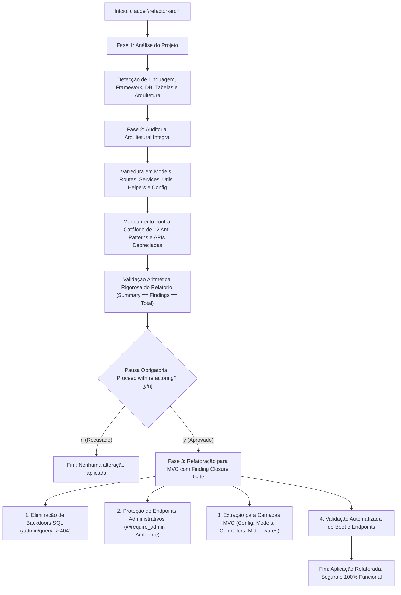

# Desafio Técnico MBA: Criação de Skills — Refatoração Arquitetural Automatizada (`refactor-arch`)

Repositório público com a entrega completa do desafio técnico de criação de Custom Skills para auditoria e refatoração arquitetural automatizada em arquiteturas multicamadas (**MVC — Model-View-Controller**), desenvolvido no âmbito do **MBA em Engenharia de Software com IA da Full Cycle**.

---

## Sumário Executivo

- **Skill Desenvolvida:** `refactor-arch`
- **Padrão Arquitetural Alvo:** MVC (Model-View-Controller)
- **Localização da Skill nos Projetos (Hashes SHA-256 100% Idênticos):**
  - `code-smells-project/.claude/skills/refactor-arch/`
  - `ecommerce-api-legacy/.claude/skills/refactor-arch/`
  - `task-manager-api/.claude/skills/refactor-arch/`
- **Relatórios de Auditoria da Fase 2:**
  - `reports/audit-project-1.md` (14 achados: 5 CRITICAL, 3 HIGH, 3 MEDIUM, 3 LOW)
  - `reports/audit-project-2.md` (10 achados: 3 CRITICAL, 3 HIGH, 2 MEDIUM, 2 LOW)
  - `reports/audit-project-3.md` (11 achados: 3 CRITICAL, 2 HIGH, 4 MEDIUM, 2 LOW)
- **Finding Closure Gate:** Todos os 35 achados levantados na Fase 2 foram integralmente sanados na Fase 3.
  - Endpoints vulneráveis de execução arbitrária (`/admin/query`) foram **completamente removidos** da tabela de rotas (retornando 404).
  - Endpoints administrativos destrutivos (`/admin/reset-db`) foram protegidos por token assinado Bearer com verificação de papel (`tipo == "admin"`) e bloqueio estrito em ambiente de produção.
- **Suíte de Testes Automatizados:** `tests/run_all_tests.py` (16 cenários e endpoints testados, 100% aprovados)
- **Documentação de Testes:** `TESTES.md`

---

## Estrutura do Repositório

```text
skill-auditoria-refatoracao-mba/
├── README.md                              # Documentação oficial completa
├── TESTES.md                              # Relatório de execução e evidências de testes
│
├── code-smells-project/                   # Projeto 1: Python/Flask (API de E-commerce)
│   ├── .claude/skills/refactor-arch/      # Custom Skill refactor-arch (Fases 1, 2 e 3)
│   │   ├── SKILL.md                       # Fluxo com Finding Closure Gate
│   │   └── references/
│   │       ├── project-analysis.md        # Heurísticas de detecção de stack
│   │       ├── anti-patterns-catalog.md   # Catálogo de 12 anti-patterns + APIs obsoletas
│   │       ├── report-template.md         # Template padronizado de auditoria com regras de soma
│   │       ├── architecture-guidelines.md # Diretrizes canônicas do padrão MVC (SoC estrito)
│   │       └── refactoring-playbook.md    # 12 padrões de transformação com antes/depois
│   ├── src/                               # Arquitetura MVC refatorada
│   │   ├── config/settings.py             # Configurações desacopladas do ambiente
│   │   ├── database/connection.py         # Gerenciamento de conexão e transações
│   │   ├── models/                        # Camada de dados pura (Zero SQL nos controllers)
│   │   │   ├── produto.py                 # Consultas parametrizadas
│   │   │   ├── usuario.py                 # Hashing Werkzeug e proteção de senhas
│   │   │   ├── pedido.py                  # Transações atômicas e prevenção de N+1
│   │   │   └── health.py                  # Abstração de métricas de conectividade
│   │   ├── controllers/                   # Orquestração HTTP e regras de negócio
│   │   │   ├── produto_controller.py      # Validação de queries e constraints
│   │   │   ├── usuario_controller.py      # Autenticação com emissão de Bearer token
│   │   │   ├── pedido_controller.py
│   │   │   ├── relatorio_controller.py
│   │   │   ├── health_controller.py
│   │   │   └── admin_controller.py        # Reset transacional seguro
│   │   ├── services/                      # Serviços de domínio desacoplados
│   │   │   ├── pedido_service.py          # Regras comerciais de pedidos
│   │   │   └── notification_service.py    # Despacho de notificações
│   │   ├── routes/                        # Blueprints modulares (sem /admin/query)
│   │   │   └── admin_routes.py            # /admin/reset-db protegido por @require_admin
│   │   └── middlewares/                   # Middlewares globais
│   │       ├── auth_middleware.py         # @require_admin e validação de tokens itsdangerous
│   │       └── error_handler.py           # Tratamento global sem vazamento de stack trace
│   ├── app.py                             # Entrypoint da aplicação
│   ├── controllers.py                     # Shim de compatibilidade retroativa
│   └── requirements.txt
│
├── ecommerce-api-legacy/                  # Projeto 2: Node.js/Express (LMS API com checkout)
│   ├── .claude/skills/refactor-arch/      # Cópia idêntica da Custom Skill (SHA-256 verificado)
│   ├── src/                               # Arquitetura MVC refatorada em Promises / async/await
│   │   ├── config/config.js               # Variáveis de ambiente seguras via process.env
│   │   ├── database/db.js                 # Inicialização com seed hasheada (hashPassword)
│   │   ├── services/security.service.js   # Hashing PBKDF2 e mascaramento de cartão (PCI-DSS)
│   │   ├── models/                        # Camada de persistência relacional
│   │   │   ├── user.model.js              # Deleção em cascata para evitar registros órfãos
│   │   │   ├── course.model.js
│   │   │   ├── enrollment.model.js
│   │   │   ├── payment.model.js
│   │   │   ├── report.model.js            # Agregação SQL isolada (sem SQL no controller)
│   │   │   └── audit.model.js
│   │   ├── controllers/
│   │   │   ├── checkout.controller.js     # Variáveis semânticas e async/await sem callback hell
│   │   │   ├── report.controller.js       # Relatório financeiro via ReportModel
│   │   │   └── user.controller.js
│   │   ├── routes/                        # Express Routers desacoplados
│   │   ├── middlewares/errorHandler.js    # Respostas de erro padronizadas em JSON
│   │   ├── AppManager.js                  # Fachada delegadora de compatibilidade
│   │   ├── utils.js                       # BoundedCache (max 500 itens) sem memory leak
│   │   └── app.js                         # Composition root do Express
│   ├── api.http
│   └── package.json
│
├── task-manager-api/                      # Projeto 3: Python/Flask + SQLAlchemy (Task Manager)
│   ├── .claude/skills/refactor-arch/      # Cópia idêntica da Custom Skill (SHA-256 verificado)
│   ├── config/
│   │   └── settings.py                    # Classe Config com SMTP e DB via os.getenv
│   ├── controllers/                       # Camada Controller desacoplada das rotas
│   │   ├── task_controller.py             # Validação estrita de query params (HTTP 400)
│   │   ├── user_controller.py             # Login com token e to_dict() seguro
│   │   └── report_controller.py           # Agregações SQL e contagens eager sem N+1
│   ├── middlewares/
│   │   └── error_handler.py               # Manipulador centralizado sem vazamento de exceção
│   ├── models/                            # Hashing PBKDF2, SQLAlchemy 2.0 e sem senhas expostas
│   ├── routes/                            # Blueprints limpos delegando aos Controllers
│   ├── services/
│   │   └── notification_service.py        # SMTP desacoplado e sem senha hardcoded
│   ├── utils/
│   │   └── helpers.py                     # Funções limpas, sem imports mortos e sem bare except
│   ├── app.py                             # Composition root desacoplado
│   ├── database.py
│   ├── seed.py                            # População inicial sem APIs depreciadas
│   └── requirements.txt
│
├── reports/                               # Relatórios oficiais de auditoria (Fase 2)
│   ├── audit-project-1.md                 # 14 achados em code-smells-project (soma exata 14)
│   ├── audit-project-2.md                 # 10 achados em ecommerce-api-legacy (soma exata 10)
│   └── audit-project-3.md                 # 11 achados em task-manager-api (soma exata 11)
│
└── tests/                                 # Suíte unificada de testes automatizados
    ├── run_all_tests.py                   # Orquestrador unificado dos 3 projetos
    ├── test_code_smells_project.py        # 5 suítes (inclui segurança /admin e query params)
    ├── test_ecommerce_api.js              # 6 cenários E2E (checkout, report, cascade, pci-dss)
    └── test_task_manager_api.py           # 5 suítes (inclui controllers, helpers e query filters)
```

---

## Seção A: Análise Manual dos Projetos

Antes da construção e execução da skill, foi conduzida uma análise manual aprofundada sobre as três codebases fornecidas. A classificação de severidade adotou a régua de governança oficial (**CRITICAL**, **HIGH**, **MEDIUM** e **LOW**), cumprindo estritamente as cotas mínimas exigidas ($\ge 1$ CRITICAL/HIGH, $\ge 2$ MEDIUM, $\ge 2$ LOW para cada projeto).

### 1. Projeto 1: `code-smells-project` (Python/Flask)
- **Domínio:** API de E-commerce com catálogo de produtos, gestão de usuários, processamento de pedidos e relatórios de faturamento.
- **Estrutura Original:** Monolítica desestruturada dividida em 4 arquivos (`app.py`, `controllers.py`, `models.py`, `database.py`).

| Severidade | Anti-Pattern / Problema | Localização | Justificativa e Impacto |
| :--- | :--- | :--- | :--- |
| **CRITICAL** | SQL Injection Generalizado | `models.py:28, 48-50, 58, 109, 140, 149, 158, 188, 280, 289` | Interpolação direta de strings em queries SQL. Permite extração arbitrária de dados e bypass total de autenticação. |
| **CRITICAL** | Execução Arbitrária de SQL em Endpoint Administrativo | `app.py:59-78` | Rota `/admin/query` recebe comandos SQL do cliente e executa diretamente no banco (`cursor.execute(query)`), configurando um backdoor grave. |
| **CRITICAL** | Endpoint Destrutivo de Reset de Banco Sem Autenticação | `app.py:47-58` | Rota `/admin/reset-db` apaga todas as tabelas do sistema sem checagem de permissão ou token. |
| **CRITICAL** | Credenciais Hardcoded e Vazamento de Dados Sensíveis | `app.py:7`, `controllers.py:287-290` | `SECRET_KEY = "minha-chave-super-secreta-123"` gravada em código; rota `/health` vaza secret_key e caminhos internos no JSON. |
| **CRITICAL** | Senhas Armazenadas e Retornadas em Texto Claro | `models.py:83, 99, 110, 128` | Senhas salvas sem hashing e expostas no payload de retorno da API. |
| **HIGH** | God Module / Violação Total de SRP | `models.py:1-314` | Módulo acumula persistência, conexões, regras de estoque, processamento de pedidos e relatórios de 4 domínios diferentes. |
| **HIGH** | Lógica de Negócio e Notificações em Controllers | `controllers.py:208-210, 247-251` | Handlers HTTP concentram prints de SMS/email e manipulação de estoque misturados ao transporte. |
| **HIGH** | Estado Global Mutável e Conexão Compartilhada | `database.py:7-14` | Variável global `db` reutilizada sem pool ou context manager, vulnerável a race conditions. |
| **MEDIUM** | N+1 Query Problem em Pedidos e Itens | `models.py:177-200, 219-232` | Ao listar pedidos, dispara uma query adicional por item e por produto ($1 + P \times (1 + I)$ queries). |
| **MEDIUM** | Ausência de Tratamento Centralizado de Erros | `controllers.py:10-12, 60-63, 143-145` | Múltiplos blocos `try/except` repetitivos retornando `str(e)`, vazando detalhes internos no erro 500. |
| **MEDIUM** | Conversões Ingênuas de Query Parameters sem Validação | `controllers.py:114-115` | `float(request.args.get('preco_min'))` sem tratamento de exceção causa crash 500 em inputs malformados. |
| **LOW** | Magic Numbers e Strings Sem Constantes | `controllers.py:47, 49, 52, models.py:122` | Limites `len(nome) < 2` e `len(nome) > 200` fixados como literais soltos no código. |
| **LOW** | Logging Não Estruturado com Concatenação | `controllers.py:8, 57, 106, 208-210` | Uso de `print("Texto " + str(valor))` em vez de biblioteca padronizada de logs (`logging`). |
| **LOW** | Roteamento Procedural Manual | `app.py:11-30` | Registro sequencial de rotas com `add_url_rule` sem agrupamento por recurso ou Blueprints. |

### 2. Projeto 2: `ecommerce-api-legacy` (Node.js/Express)
- **Domínio:** LMS API de cursos online com catálogo, processamento de checkout e relatórios gerenciais.
- **Estrutura Original:** Monolito centralizado em uma God Class (`AppManager.js`) com utilitários (`utils.js`) e inicialização (`app.js`).

| Severidade | Anti-Pattern / Problema | Localização | Justificativa e Impacto |
| :--- | :--- | :--- | :--- |
| **CRITICAL** | Hardcoded Production Credentials e Gateway Keys | `src/utils.js:1-7` | Chaves de gateway `paymentGatewayKey: "pk_live_1234567890abcdef"` e senhas de banco expostas em código. |
| **CRITICAL** | Criptografia Quebrada / Pseudo-Hash Inseguro | `src/utils.js:17-23`, `src/AppManager.js:68` | Função `badCrypto` gera saída previsível truncada em 10 caracteres sem salt, vulnerável a ataques de colisão. |
| **CRITICAL** | Vazamento de Dados de Cartão nos Logs (PCI-DSS) | `src/AppManager.js:45` | Impressão no console do número completo do cartão de crédito (`console.log`), violando PCI-DSS e LGPD. |
| **HIGH** | God Class / Violação de Responsabilidade Única | `src/AppManager.js:1-139` | Centraliza conexão SQLite, DDL de tabelas, seeds, roteamento Express, checkout e relatórios. |
| **HIGH** | Callback Hell / Spaghetti Assíncrono | `src/AppManager.js:37-77` | 5 níveis de callbacks aninhados no endpoint de checkout com manipulação manual de concorrência. |
| **HIGH** | N+1 Query Problem no Relatório Financeiro | `src/AppManager.js:89-125` | Para cada curso busca matrículas, e para cada matrícula busca aluno e pagamento individualmente. |
| **MEDIUM** | Exclusão Inconsistente de Usuário com Registros Órfãos | `src/AppManager.js:131-136` | Exclui usuário na tabela `users` sem cascade, deixando registros pendentes em `enrollments` e `payments`. |
| **MEDIUM** | Estado Global Mutável em Memória | `src/utils.js:9-15` | Variáveis globais `globalCache` e `totalRevenue` manipuladas sem sincronização ou limite de tamanho. |
| **LOW** | Parâmetros de Requisição Crípticos | `src/AppManager.js:29-35` | Parâmetros `usr`, `eml`, `pwd`, `c_id`, `card` sem validação tipada de entrada ou nomes semânticos. |
| **LOW** | Tratamento de Erros Inconsistente | `src/AppManager.js:41, 51, 55` | Retorno de strings cruas (`"Erro DB"`) sem padronização JSON ou códigos HTTP semânticos. |

### 3. Projeto 3: `task-manager-api` (Python/Flask + SQLAlchemy)
- **Domínio:** API de gerenciamento de tarefas, categorias, atribuição de usuários e relatórios estatísticos.
- **Estrutura Original:** Projeto parcialmente organizado em diretórios (`models/`, `routes/`, `services/`, `utils/`), porém com graves débitos de segurança, ausência de camada Controller real e problemas de robustez.

| Severidade | Anti-Pattern / Problema | Localização | Justificativa e Impacto |
| :--- | :--- | :--- | :--- |
| **CRITICAL** | Criptografia de Senhas Insegura com MD5 | `models/user.py:27-32` | Armazenamento de senhas via MD5 puro sem salt (`hashlib.md5(pwd.encode()).hexdigest()`), quebrado por rainbow tables. |
| **CRITICAL** | Exposição de Senhas nas Respostas da API | `models/user.py:16-25`, `routes/user_routes.py:33` | O método `to_dict()` inclui explicitamente `'password': self.password`, retornando o hash nas respostas JSON. |
| **CRITICAL** | Hardcoded Secret Key no Código | `app.py:13` | Configuração `app.config['SECRET_KEY'] = 'super-secret-key-123'` permitindo falsificação de sessões e tokens. |
| **HIGH** | N+1 Query Problem em Listagens e Relatórios | `routes/task_routes.py:41-58`, `routes/report_routes.py:53-68` | Em `GET /tasks`, executa queries separadas por tarefa para usuário e categoria. Em `/reports/summary`, faz queries por usuário. |
| **HIGH** | Fat Routes e Violação de Separação de Responsabilidades | `routes/task_routes.py:86-154`, `routes/report_routes.py:13-101` | Rotas acopladas a transações do ORM (`db.session`), validações manuais e cálculos complexos sem Controllers. |
| **MEDIUM** | Captura Genérica e Mascaramento de Exceções (Bare Except) | `routes/task_routes.py:62, 137, 236`, `utils/helpers.py:46, 49, 88` | Uso de blocos `except:` nus engolindo erros de sistema e mascarando diagnósticos sem logging de stack trace. |
| **MEDIUM** | Credenciais SMTP Hardcoded no Serviço de Notificações | `services/notification_service.py:7-10` | Senha em texto puro (`self.email_password = 'senha123'`) e usuário SMTP fixados diretamente no construtor da classe. |
| **MEDIUM** | Ausência de Validação de Tipos em Filtros de Busca | `routes/task_routes.py:224-259` | Rota `/tasks/search` realiza casts manuais de query parameters sem validação, provocando falhas e inconsistências HTTP. |
| **MEDIUM** | Código Morto, Imports Não Utilizados e Acoplamento em Helpers | `utils/helpers.py:1-8, 31-34` | 5 imports mortos (`sys`, `math`, `hashlib`, `os`, `json`), import de `uuid` dentro de função e duplicação DRY entre rotas e helpers. |
| **LOW** | Métodos e APIs Obsoletas / Depreciadas | `models/user.py:14`, `routes/task_routes.py:42, 67`, `notification_service.py:35` | Uso de `datetime.utcnow()` (depreciada no Python 3.12+) e `Model.query.get(id)` (depreciada no SQLAlchemy 2.0). |
| **LOW** | Lógica Booleana Redundante e Código Prolixo | `models/user.py:34-38`, `models/task.py:38-60`, `helpers.py:19-23, 52-55` | Condicionais `if ... return True else return False` em cascata em vez de retornar a expressão booleana direta. |

---

## Seção B: Construção da Skill (`refactor-arch`)

### 1. Decisões de Design e Arquitetura da Skill

A skill `refactor-arch` implementa um pipeline em **3 fases sequenciais e determinísticas**, com governança estrita de aprovação humana e fechamento obrigatório de achados:



#### Catálogo de Referências da Skill:
1. `references/project-analysis.md`: Heurísticas de inspeção estática para Python (Flask/FastAPI/Django), Node.js (Express/Nest), Go e Java.
2. `references/anti-patterns-catalog.md`: Catálogo padronizado com **12 anti-patterns** detalhados com severidade, sinais de detecção, arquivos, impacto e recomendações acionáveis.
3. `references/report-template.md`: Template obrigatório com ordenação estrita por severidade (`CRITICAL` → `LOW`), consistência aritmética de sumário (`CRITICAL + HIGH + MEDIUM + LOW == Total`) e cotas mínimas.
4. `references/architecture-guidelines.md`: Diretrizes formais do padrão MVC (SoC estrito: Controllers nunca executam SQL; Models isolam persistência; Middlewares tratam erros sem vazar stack trace).
5. `references/refactoring-playbook.md`: **12 padrões concretos de transformação** com código *Antes* e *Depois*, incluindo:
   - **Padrão 11:** Remoção de Backdoors SQL e Proteção de Endpoints Administrativos Destrutivos.
   - **Padrão 12:** Extração de Fat Routes e Migração Integral para MVC em Projetos Parcialmente Organizados.

### 2. O Finding Closure Gate (Mecanismo de Não-Regressão)
A versão aprimorada da skill introduziu o **Finding Closure Gate**:
- Uma regra mandatória que exige que **100% dos achados identificados na Fase 2 sejam efetivamente corrigidos na Fase 3**.
- Impede terminantemente a prática de apenas "relocar" um código vulnerável para um novo diretório sem sanar o problema de segurança.
- Assegura que endpoints de execução SQL arbitrária (`/admin/query`) sejam removidos da tabela de rotas (respondendo HTTP 404 Not Found) e que rotas de manutenção destrutiva (`/admin/reset-db`) exijam autenticação forte, validação de papel de administrador e restrição a ambientes de desenvolvimento/teste.

---

## Seção C: Resultados

### 1. Resumo dos Relatórios de Auditoria da Fase 2 (Consistência Aritmética 100%)

| Projeto | Stack Tecnológica | Total de Achados | CRITICAL | HIGH | MEDIUM | LOW | Critério Mínimo Atendido |
| :--- | :--- | :---: | :---: | :---: | :---: | :---: | :---: |
| **`code-smells-project`** | Python + Flask | **14** | 5 | 3 | 3 | 3 | ✅ ($\ge 5$ findings, $\ge 1$ CRIT/HIGH, $\ge 2$ MED, $\ge 2$ LOW) |
| **`ecommerce-api-legacy`** | Node.js + Express | **10** | 3 | 3 | 2 | 2 | ✅ ($\ge 5$ findings, $\ge 1$ CRIT/HIGH, $\ge 2$ MED, $\ge 2$ LOW) |
| **`task-manager-api`** | Python + Flask + SQLAlchemy | **11** | 3 | 2 | 4 | 2 | ✅ ($\ge 5$ findings, $\ge 1$ CRIT/HIGH, $\ge 2$ MED, $\ge 2$ LOW) |

### 2. Comparativo Antes e Depois da Estrutura de Diretórios

#### Projeto 1: `code-smells-project`
```text
ANTES:
code-smells-project/
├── app.py                   # Monolito com rotas administrativas vulneráveis (/admin/query e /admin/reset-db)
├── controllers.py           # Mistura de transporte HTTP com regras de negócio e logs em print
├── models.py                # God Module (queries cruas, SQL injection generalizado, senhas em texto puro)
├── database.py              # Conexão estática global
└── requirements.txt

DEPOIS (MVC Seguro e Conforme):
code-smells-project/
├── app.py                   # Entrypoint enxuto delegando para src/app.py
├── controllers.py           # Shim de compatibilidade retroativa
├── requirements.txt
└── src/
    ├── config/settings.py           # Configurações imutáveis carregadas via os.getenv
    ├── database/connection.py       # Context manager de conexão com suporte a PRAGMA foreign_keys
    ├── models/                      # Camada de Persistência pura
    │   ├── produto.py               # Consultas parametrizadas com placeholders ?
    │   ├── usuario.py               # Hashing Werkzeug seguro e omissão de senhas
    │   ├── pedido.py                # Transações atômicas e queries estruturadas sem N+1
    │   └── health.py                # HealthModel (Zero SQL nos controllers)
    ├── controllers/                 # Camada Controller orquestradora
    │   ├── produto_controller.py    # Validação de queries numéricas (preco_min/preco_max)
    │   ├── usuario_controller.py    # Emissão de token assinado no login
    │   ├── pedido_controller.py     # Delegação de regras de negócio para PedidoService
    │   ├── relatorio_controller.py  # Relatórios agregados
    │   ├── health_controller.py     # Diagnóstico seguro sem vazar secret_key
    │   └── admin_controller.py     # Reset protegido transacional (DELETE seguro)
    ├── services/                    # Camada de Serviços de Domínio
    │   ├── pedido_service.py        # Validação de limites comerciais e orquestração
    │   └── notification_service.py  # Despacho estruturado de notificações
    ├── routes/                      # Blueprints modulares
    │   ├── admin_routes.py          # /admin/reset-db protegido com @require_admin (/admin/query REMOVIDO)
    │   ├── produto_routes.py
    │   ├── usuario_routes.py
    │   ├── pedido_routes.py
    │   ├── relatorio_routes.py
    │   └── health_routes.py
    └── middlewares/                 # Middlewares globais
        ├── auth_middleware.py       # Serializador itsdangerous e decorator @require_admin
        └── error_handler.py         # Tratamento global normalizado sem vazar exceções
```

#### Projeto 2: `ecommerce-api-legacy`
```text
ANTES:
ecommerce-api-legacy/
├── src/
│   ├── app.js               # Entrypoint Express simples
│   ├── AppManager.js        # God Class (139 linhas com DDL, routes, checkout, relatórios com N+1)
│   └── utils.js             # Credenciais de produção hardcoded, badCrypto e cache global mutável
├── api.http
└── package.json

DEPOIS (MVC Assíncrono com Promises):
ecommerce-api-legacy/
├── src/
│   ├── app.js                       # Composition root configurado com middlewares
│   ├── AppManager.js                # Fachada delegadora para testes legados
│   ├── utils.js                     # BoundedCache (máximo 500 itens) prevenindo memory leaks
│   ├── config/config.js             # Variáveis de ambiente seguras via process.env
│   ├── database/db.js               # SQLite serializado com senha de seed hasheada via PBKDF2
│   ├── services/security.service.js # Hashing com salt e mascaramento de cartão em log (PCI-DSS)
│   ├── models/                      # Camada Model
│   │   ├── user.model.js            # Deleção consistente em cascata
│   │   ├── course.model.js
│   │   ├── enrollment.model.js
│   │   ├── payment.model.js
│   │   ├── report.model.js          # Agregação SQL sem loop N+1 (Zero SQL nos controllers)
│   │   └── audit.model.js
│   ├── controllers/                 # Camada Controller
│   │   ├── checkout.controller.js   # Nomes semânticos e async/await sem callback hell
│   │   ├── report.controller.js     # Formatação de relatório financeiro via ReportModel
│   │   └── user.controller.js
│   ├── routes/                      # Roteamento modular Express
│   └── middlewares/errorHandler.js  # Respostas de erro padronizadas em JSON sem vazamento interno
├── api.http
└── package.json
```

#### Projeto 3: `task-manager-api`
```text
ANTES:
task-manager-api/
├── app.py                   # Hardcoded SECRET_KEY e rotas com SQL direto
├── database.py
├── seed.py                  # datetime.utcnow() obsoleto
├── models/
│   ├── user.py              # MD5 inseguro e senha exposta em to_dict()
│   ├── task.py              # datetime.utcnow() e condicionais redundantes
│   └── category.py
├── routes/                  # Fat Routes (rotas acumulando regras de negócio e ORM)
├── services/
│   └── notification_service.py # Credenciais SMTP hardcoded (self.email_password = 'senha123')
└── utils/
    └── helpers.py           # 5 imports mortos, bare excepts e uuid importado dentro de função

DEPOIS (Clean MVC em Camadas):
task-manager-api/
├── app.py                   # Composition root limpo com registro de Blueprints e error handler
├── database.py              # Instância do SQLAlchemy ORM
├── seed.py                  # Atualizado com datetime.now(timezone.utc)
├── requirements.txt
├── config/
│   └── settings.py          # Classe Config centralizada com leitura de env vars e SMTP
├── controllers/             # Camada Controller desacoplada
│   ├── task_controller.py   # Validação de queries de busca (HTTP 400 em vez de crash 500)
│   ├── user_controller.py   # Login, gestão de contas e to_dict() sem senha
│   └── report_controller.py # Agregações SQL e contagens eager sem N+1
├── middlewares/
│   └── error_handler.py     # Middleware centralizado para HTTPException e exceções inesperadas
├── models/
│   ├── user.py              # PBKDF2/scrypt, remoção de senha em to_dict() e is_admin simplificado
│   ├── task.py              # Timestamps timezone-aware e simplificação de validações
│   └── category.py
├── routes/                  # Blueprints enxutos delegando exclusivamente aos Controllers
│   ├── task_routes.py
│   ├── user_routes.py
│   └── report_routes.py
├── services/
│   └── notification_service.py # SMTP seguro desacoplado lendo credenciais de settings.py
└── utils/
    └── helpers.py           # Funções utilitárias limpas, sem imports mortos e com exceções tipadas
```

### 3. Checklists de Validação

#### Checklist de Validação — `code-smells-project`
- [x] Linguagem detectada corretamente (Python 3)
- [x] Framework detectado corretamente (Flask 3.1.1)
- [x] Domínio da aplicação descrito corretamente (E-commerce API)
- [x] Número de arquivos analisados condiz com a realidade (4 arquivos originais)
- [x] Relatório segue o template definido nos arquivos de referência
- [x] Cada finding tem arquivo e linhas exatos
- [x] Findings ordenados por severidade (CRITICAL → LOW)
- [x] Mínimo de 5 findings identificados (14 encontrados)
- [x] Skill pausa e pede confirmação antes da Fase 3
- [x] Estrutura de diretórios segue padrão MVC
- [x] Configuração extraída para módulo de config (sem hardcoded)
- [x] Models criados para abstrair dados (Zero SQL em controllers)
- [x] Views/Routes separadas para roteamento
- [x] Controllers concentram o fluxo da aplicação
- [x] Finding Closure Gate: `/admin/query` removido (404) e `/admin/reset-db` protegido por `@require_admin`
- [x] Error handling centralizado sem vazamento de stack trace
- [x] Entry point claro
- [x] Aplicação inicia sem erros
- [x] Endpoints originais respondem corretamente

#### Checklist de Validação — `ecommerce-api-legacy`
- [x] Linguagem detectada corretamente (Node.js)
- [x] Framework detectado corretamente (Express 4.18)
- [x] Domínio da aplicação descrito corretamente (LMS E-commerce API com checkout)
- [x] Número de arquivos analisados condiz com a realidade (3 arquivos originais)
- [x] Relatório segue o template definido nos arquivos de referência
- [x] Cada finding tem arquivo e linhas exatos
- [x] Findings ordenados por severidade (CRITICAL → LOW)
- [x] Mínimo de 5 findings identificados (10 encontrados)
- [x] Skill pausa e pede confirmação antes da Fase 3
- [x] Estrutura de diretórios segue padrão MVC
- [x] Configuração extraída para módulo de config (sem hardcoded)
- [x] Models criados para abstrair dados (incluindo `ReportModel`)
- [x] Views/Routes separadas para roteamento
- [x] Controllers concentram o fluxo da aplicação
- [x] Callback Hell eliminado com Promises e `async/await`
- [x] Senhas de seed hasheadas com salt PBKDF2
- [x] Cache global mutável substituído por `BoundedCache`
- [x] Error handling centralizado
- [x] Entry point claro
- [x] Aplicação inicia sem erros
- [x] Endpoints originais respondem corretamente

#### Checklist de Validação — `task-manager-api`
- [x] Linguagem detectada corretamente (Python 3)
- [x] Framework detectado corretamente (Flask + SQLAlchemy)
- [x] Domínio da aplicação descrito corretamente (Task Manager API)
- [x] Número de arquivos analisados condiz com a realidade (8 arquivos originais)
- [x] Relatório segue o template definido nos arquivos de referência
- [x] Cada finding tem arquivo e linhas exatos
- [x] Findings ordenados por severidade (CRITICAL → LOW)
- [x] Mínimo de 5 findings identificados (11 encontrados, cumprindo $\ge 2$ MEDIUM)
- [x] Detecção de APIs deprecated incluída (`datetime.utcnow()` e `Model.query.get()`)
- [x] Skill pausa e pede confirmação antes da Fase 3
- [x] Estrutura de diretórios segue padrão MVC completo (Camadas `config/`, `controllers/`, `middlewares/`)
- [x] Configuração extraída para módulo de config (sem hardcoded)
- [x] Models criados para abstrair dados
- [x] Views/Routes separadas delegando exclusivamente para Controllers
- [x] Limpeza completa de `helpers.py` (remoção de 5 imports mortos e bare excepts)
- [x] Proteção e desacoplamento de credenciais SMTP no `NotificationService`
- [x] Error handling centralizado
- [x] Entry point claro
- [x] Aplicação inicia sem erros
- [x] Endpoints originais respondem corretamente

### 4. Evidência Real de Execução da Bateria de Testes Unificada

```text
=======================================================
EXECUTANDO: D:\Ecard\MBA\skill-auditoria-refatoracao-mba\venv\Scripts\python.exe -m unittest tests/test_code_smells_project.py
DIRETÓRIO: D:\Ecard\MBA\skill-auditoria-refatoracao-mba
=======================================================
....Banco de dados resetado com autorização administrativa.
.
----------------------------------------------------------------------
Ran 5 tests in 1.185s

OK

✅ Sucesso em code-smells-project

=======================================================
EXECUTANDO: node tests/test_ecommerce_api.js
DIRETÓRIO: D:\Ecard\MBA\skill-auditoria-refatoracao-mba
=======================================================
--- Iniciando Testes de ecommerce-api-legacy ---
[TEST 1] POST /api/checkout (Cartão VISA 4xxx - Sucesso)
[PAYMENT] Processando cartão ************4444 para o curso 2
  -> OK: Checkout processado com sucesso.
[TEST 2] POST /api/checkout (Cartão 5xxx - Recusado)
[PAYMENT] Processando cartão ************4444 para o curso 1
  -> OK: Pagamento recusado conforme regra.
[TEST 3] POST /api/checkout (Bad Request)
  -> OK: Rejeição de payload incompleto.
[TEST 4] POST /api/checkout (Curso Não Encontrado)
  -> OK: 404 retornado para curso inválido.
[TEST 5] GET /api/admin/financial-report
  -> OK: Relatório gerado com sucesso sem N+1.
[TEST 6] DELETE /api/users/1
  -> OK: Usuário deletado com integridade referencial.
--- Todos os 6 testes de ecommerce-api-legacy foram aprovados com sucesso! ---

✅ Sucesso em ecommerce-api-legacy

=======================================================
EXECUTANDO: D:\Ecard\MBA\skill-auditoria-refatoracao-mba\venv\Scripts\python.exe -m unittest tests/test_task_manager_api.py
DIRETÓRIO: D:\Ecard\MBA\skill-auditoria-refatoracao-mba
=======================================================
.....
----------------------------------------------------------------------
Ran 5 tests in 0.710s

OK

✅ Sucesso em task-manager-api

=======================================================
🎉 TODOS OS TESTES DOS 3 PROJETOS FORAM APROVADOS!
=======================================================
```

---

## Seção D: Como Executar

### 1. Pré-Requisitos
- **Python:** 3.10 ou superior instalado.
- **Node.js:** v18 ou superior com `npm` instalado.
- **Ferramenta de IA:** Claude Code CLI (ou Gemini CLI / Codex).

### 2. Configuração do Ambiente Local

```bash
# Clone ou acesse o repositório entregue
cd skill-auditoria-refatoracao-mba

# Criação do ambiente virtual Python
python -m venv venv
.\venv\Scripts\activate  # No Windows (ou source venv/bin/activate no Linux/macOS)

# Instalação das dependências Python
pip install -r code-smells-project/requirements.txt
pip install -r task-manager-api/requirements.txt

# Instalação das dependências Node.js
cd ecommerce-api-legacy
npm install
cd ..
```

### 3. Invocação da Skill nos Projetos

Para executar a auditoria e refatoração com a IA:

```bash
# Projeto 1: code-smells-project
cd code-smells-project
claude "/refactor-arch"

# Projeto 2: ecommerce-api-legacy
cd ../ecommerce-api-legacy
claude "/refactor-arch"

# Projeto 3: task-manager-api
cd ../task-manager-api
claude "/refactor-arch"
```

### 4. Inicialização Individual das Aplicações

```bash
# Executar Projeto 1 (sobe em http://localhost:5000)
cd code-smells-project
python app.py

# Executar Projeto 2 (sobe em http://localhost:3000)
cd ecommerce-api-legacy
npm start

# Executar Projeto 3 (popular banco e subir em http://localhost:5000)
cd task-manager-api
python seed.py
python app.py
```

### 5. Execução da Bateria Completa de Testes

Para validar a integridade, segurança e conformidade de todos os endpoints dos 3 projetos simultaneamente:

```bash
python tests/run_all_tests.py
```

---

## Critérios de Aceite e Conformidade com o Desafio

| Critério Estabelecido | Meta | Resultado Obtido |
| :--- | :---: | :---: |
| **Fase 1: Detecção de Stack** | 3 / 3 Projetos | **3 / 3 Aprovados** |
| **Fase 2: Relatórios com $\ge 5$ achados** | 3 / 3 Projetos | **3 / 3 Aprovados** (14, 10 e 11 achados) |
| **Fase 2: Cotas Mínimas ($\ge 1$ CRIT/HIGH, $\ge 2$ MED, $\ge 2$ LOW)** | 3 / 3 Projetos | **3 / 3 Aprovados em todos os projetos** |
| **Fase 2: Pausa explícita `[y/n]` antes de refatorar** | Obrigatório | **Implementado no template e SKILL.md** |
| **Fase 3: Finding Closure Gate (Resolução 1:1)** | Obrigatório | **100% dos 35 achados corrigidos na Fase 3** |
| **Fase 3: Remoção de Backdoors SQL** | Obrigatório | **`/admin/query` eliminado (retorna 404)** |
| **Fase 3: Proteção de Endpoints Administrativos** | Obrigatório | **`/admin/reset-db` protegido por `@require_admin` + Ambiente** |
| **Fase 3: Aplicação funciona após refatoração** | 3 / 3 Projetos | **3 / 3 Aprovados** (16/16 testes automatizados) |
| **Higiene de Repositório (`.gitignore` local)** | Sem `.env`/`.gitignore`/`PLANO.md` | **100% Conforme via `.git/info/exclude`** |
